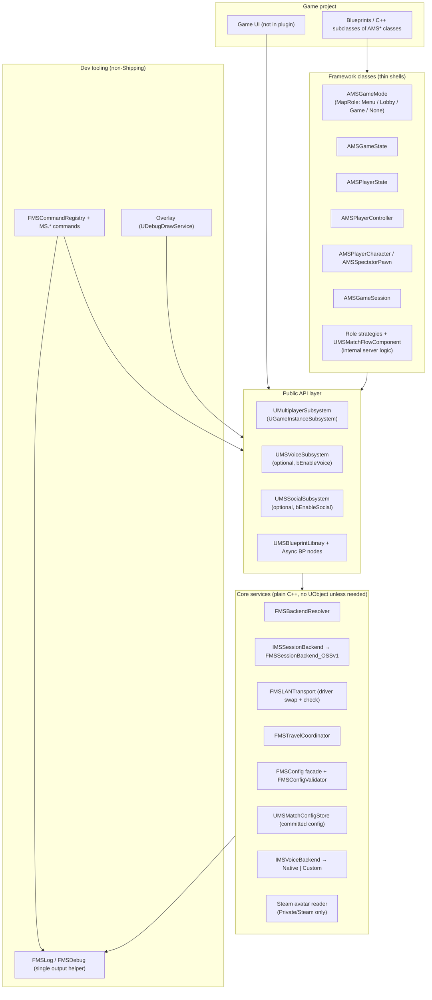
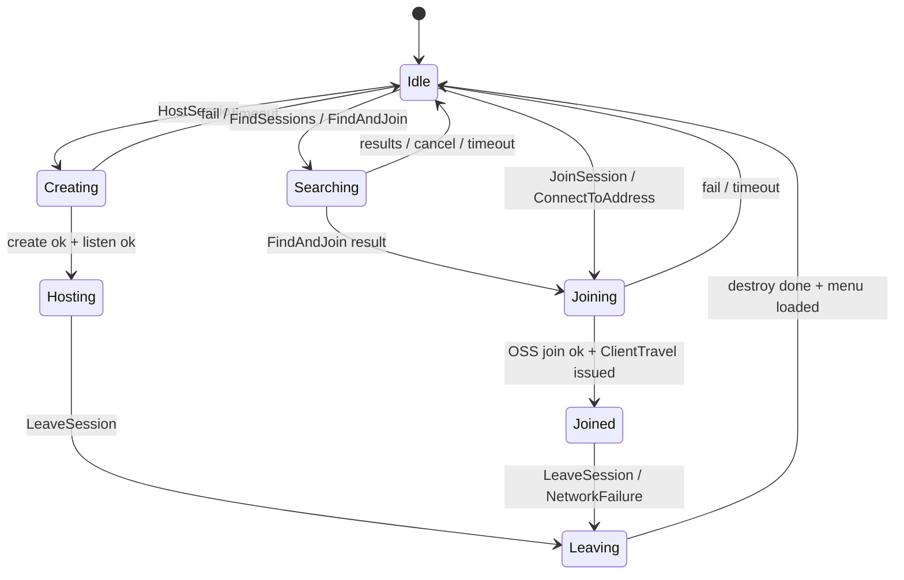
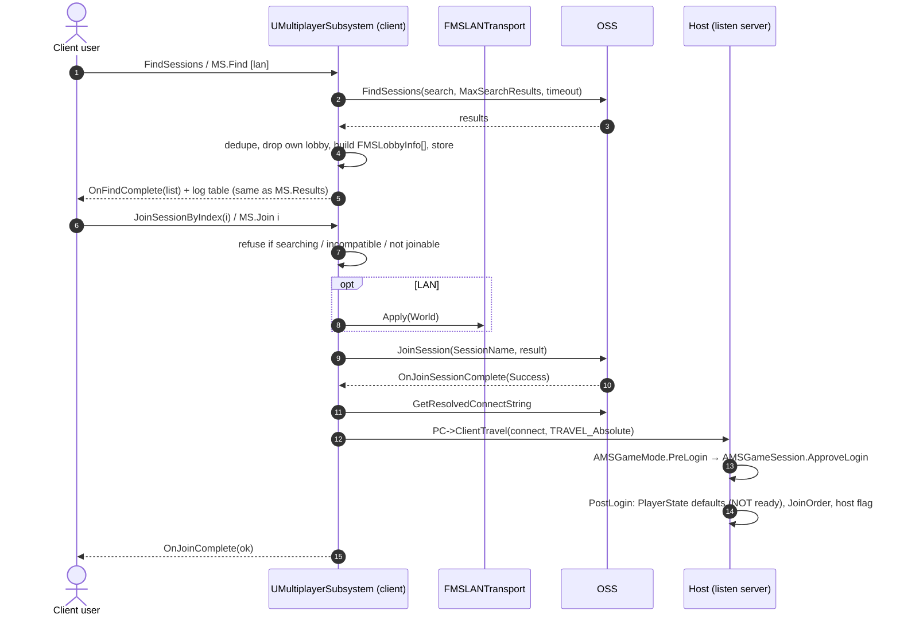
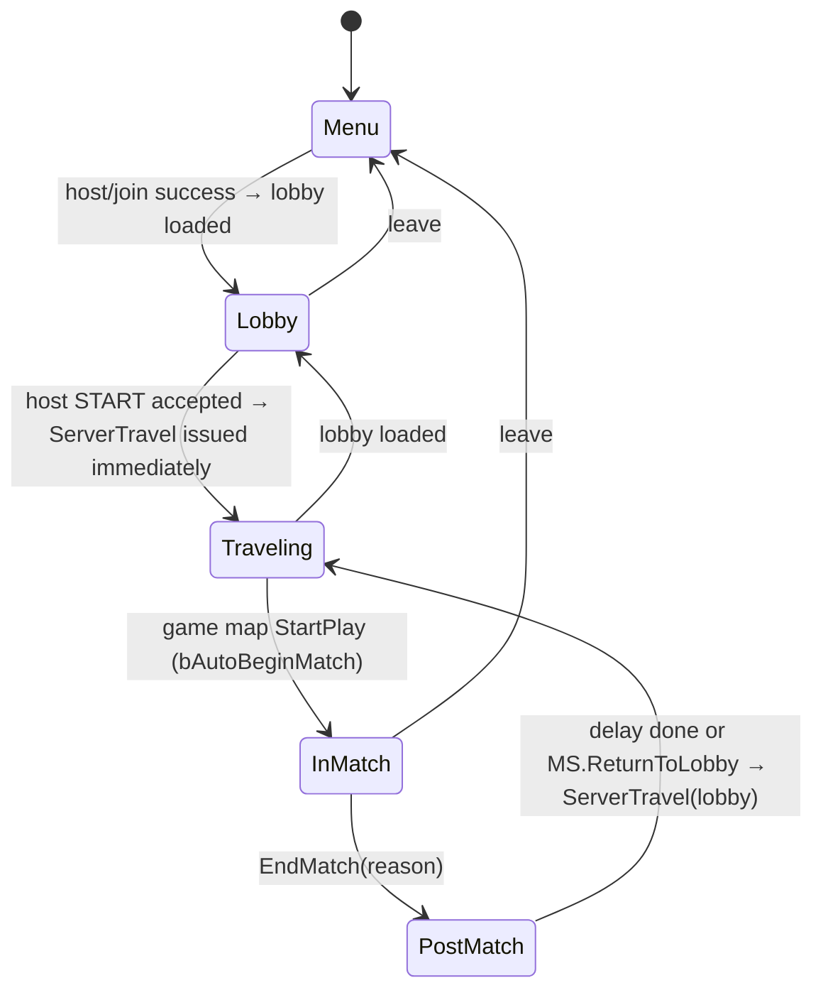
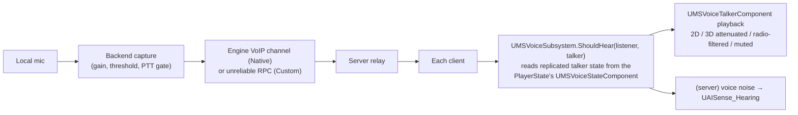

# MultiplayerSubsystem — Plugin Design

| | |
|---|---|
| **Plugin / module name** | `MultiplayerSubsystem` (API macro `MULTIPLAYERSUBSYSTEM_API`, class prefix `MS`, log category `LogMultiplayerSubsystem`) |
| **Target engine** | Unreal Engine 5.8 — any C++ or Blueprint-only project |
| **Audience** | An AI coding agent that will implement the plugin, and the humans reviewing its work |
| **Purpose** | Cut multiplayer prototyping time to near zero: host → find → join → lobby → pick map/config → play → back to lobby, testable from the console without packaging |
| **Status** | v1.1 — design complete, implementation not started. *Revision 1.1:* explicit host-only START (no countdown), Steam LAN supported in Shipping, basic Steam social layer, voice/social switchable in config, single `AMSGameMode` with `MapRole`, scope trimmed (§1.6). |

---

## Table of Contents

0. [Reading guide and agent working rules](#0-reading-guide-and-agent-working-rules)
1. [Overview](#1-overview)
2. [Decisions and resolved ambiguities](#2-decisions-and-resolved-ambiguities)
3. [Architecture](#3-architecture)
4. [Configuration](#4-configuration)
5. [Backends and transport](#5-backends-and-transport)
6. [The subsystem (public API)](#6-the-subsystem-public-api)
7. [Flows](#7-flows)
8. [Framework base classes](#8-framework-base-classes)
9. [Voice](#9-voice)
10. [Logging and debug tooling](#10-logging-and-debug-tooling)
11. [Diagnostics](#11-diagnostics)
12. [Editor module](#12-editor-module)
13. [Robustness, security, edge cases](#13-robustness-security-edge-cases)
14. [Testing](#14-testing)
15. [Implementation plan](#15-implementation-plan)
16. [Appendices](#16-appendices)

---

## 0. Reading guide and agent working rules

### 0.1 Conventions

- **MUST / MUST NOT / SHOULD / MAY** are used in the RFC 2119 sense. A MUST is a requirement; a SHOULD needs a written reason to skip.
- `⚠ VERIFY Vn` marks a place where this document relies on an engine API or behavior that was **not** confirmed against the 5.8 headers/source when this spec was written. The agent MUST confirm each one against the installed engine (grep `Engine/Source` and `Engine/Plugins/Online`) before relying on it, and record the outcome in `Docs/VERIFICATION.md`. The full list is in [Appendix A](#appendix-a--engine-api-verification-checklist).
- Code in this document is **specification-grade pseudo-C++**: names, signatures and behavior are binding; includes, `UPARAM` details and minor syntax are the agent's job.
- "Host" = the player running the listen server. "Client" = any other player. "Server" = whoever has authority (always the host; there are no dedicated servers in v1, but nothing may prevent them later).

### 0.2 Working rules for the implementing agent

1. **Build in the phases of [§15](#15-implementation-plan).** Compile and run the phase's acceptance tests before starting the next phase. Do not write everything and then compile.
2. **Never invent engine APIs.** If a signature in this document does not exist in 5.8, find the real equivalent, keep the *behavior*, and note the deviation in `Docs/VERIFICATION.md`.
3. **No hardcoded values.** Every number, string, path, color, timeout, key name and default that a developer might ever want to change MUST live in one of the settings classes of [§4](#4-configuration). The only allowed literals are *protocol constants* (e.g. session-setting key names) collected in `MSNames.h`, and structural constants in `MSConstants.h` (documented, each with a one-line reason).
4. **One logging path.** No `UE_LOG`, `GEngine->AddOnScreenDebugMessage`, `Ar.Log` or `printf` anywhere in the plugin outside `Debug/MSLog.cpp` and `Debug/MSDebug.cpp`. Everything uses the helper macros of [§10](#10-logging-and-debug-tooling). A unit test greps for violations.
5. **Thin shells, small strategies.** Gameplay-framework classes (`AMSGameMode`, `AMSPlayerState`, …) stay minimal. Role-specific server logic (menu / lobby / game) lives in small internal classes selected by `MapRole`, so `AMSGameMode` never becomes a `switch` soup.
6. **Server is the single source of truth.** Clients only *request*; the server validates and replicates. Every RPC has `WithValidation`.
7. **Shipping strip rules** ([§3.5](#35-build-flavors-and-shipping-strip-rules)) are tested by actually compiling a Shipping target.
8. **Everything async reports through a delegate AND the log.** Console commands cannot display late results, so every async completion prints via the shared helper.
9. **Game thread only.** No worker threads touch plugin state. All OSS delegate handles are stored and removed in `Deinitialize()`.
10. **Lambdas capture `TWeakObjectPtr`, never raw `this`,** when they can outlive the subsystem (PIE restarts, travel).
11. **Document as you go:** `Docs/QUICKSTART.md`, `Docs/COMMANDS.md` (generated from the command registry), `Docs/VERIFICATION.md`.

### 0.3 Global definition of done

- Plugin compiles on Win64 (Editor, Development Game, Shipping) with zero warnings in plugin code.
- Two instances on **one PC** and two PCs on one network can host/find/join over **LAN / Null (no Steam running)** in any non-Shipping build, including packaged Development/Test builds.
- Same test with Steam running and `LanBackend=Auto` still uses Null for LAN lobbies in non-Shipping builds.
- **LAN / Steam** (Steam running, LAN discovery, plain-IP transport) works on two PCs in a **Shipping** build.
- Steam internet lobby works with two Steam accounts (Spacewar/480 acceptable): friends list, invite a friend, join a friend who is playing the game (when the session allows it), own Steam name and avatar.
- The **host alone** starts the match (UI button or `MS.Start`) once players are ready or the host force-readied them; there is no countdown and no auto-start.
- Host → Lobby → (map + JSON chosen) → Game map → back to Lobby loops N times without leaks or stuck "busy" flags.
- A late joiner enters as spectator and becomes a normal player in the next lobby.
- Every command in [§10.5](#105-console-command-reference) exists, has `MS.Help` text, and prints through the shared helper.
- `MS.CheckConfig` reports every misconfiguration listed in [§11](#11-diagnostics) on a deliberately broken project.
- Shipping build contains no Null-OSS path, no `MS.*` commands, no on-screen output — but **Steam LAN still works**.
- With `bEnableVoice=false` no voice subsystem, voice state, talker component, voice commands or voice config checks exist at runtime.
- The three map roles (`Menu`, `Lobby`, `Game`) plus `None` all work from one `AMSGameMode` class; a role/map mismatch is reported by `MS.CheckConfig` and at map load.

---

## 1. Overview

### 1.1 What it is

A drop-in UE plugin that gives a project **menu → lobby → game-map(s) → lobby** multiplayer in minutes:

- A `UGameInstanceSubsystem` (`UMultiplayerSubsystem`) with a full Blueprint API for host / find / join / leave / kick / visibility / travel.
- Three connection modes: **LAN / Null** (no Steam needed, non-Shipping builds only), **LAN / Steam** (Steam identity, LAN discovery, plain-IP transport — supported in Shipping) and **Internet / Steam**.
- Ready-to-inherit framework classes — **one `AMSGameMode` with a `MapRole` enum (`Menu`, `Lobby`, `Game`, `None`)**, plus GameState, PlayerState, PlayerController, Character, Spectator, GameSession, GameInstance — containing only what the plugin needs: player counting, ready state, host flag, spectator role, match phase.
- A **match config** (selected map + an opaque JSON string) chosen by the host in the lobby, committed by the server, carried across seamless travel, and replicated to every client in the game map.
- A **voice** layer (proximity, global, team, walkie-talkie radio) that works in lobby and match, over Steam and over LAN. **Fully optional:** one config switch removes it from the runtime.
- A basic **Steam social** layer: own Steam name and avatar, friends list with presence ("playing this game"), invite a friend, join a friend who is playing the game (when the session allows it), receive/accept invites.
- A **dev toolbox**: `MS.*` console commands, on-screen/log/history output through one helper, a status overlay, a config validator, and command-line auto-host/auto-join flags.
- All behavior driven by `DeveloperSettings` classes (editable in Project Settings, saved to `DefaultGame.ini`).

### 1.2 Goals

1. **Iteration speed:** from an empty project to two joined players in a lobby in < 10 minutes, and from "edit code" to "two players in game" without packaging.
2. **Reusability:** works with any UE 5.8 project; no dependency on game-specific code; every behavior overridable by inheritance or Blueprint.
3. **Observability:** when something fails, the log, screen and `MS.Diag` say *why* and *what to fix*.
4. **Safety:** server-authoritative; dev tooling and the Null backend are compiled out of Shipping.

### 1.3 Non-goals (v1)

- Dedicated server hosting, host migration, matchmaking services, party systems, anti-cheat, accounts/auth beyond what the OSS gives.
- UI. The plugin ships **no UMG** in the runtime module (an optional example content pack is allowed in Phase 6).
- Replacing Gameplay Ability System, Lyra, or any game framework — the base classes are intentionally thin.
- Console/mobile platform backends (the `IMSSessionBackend` seam makes them possible later).
- Steam features beyond name / avatar / friends / invites / friend-join (no achievements, stats, cloud, leaderboards, workshop).
- Match start countdowns, auto-start when all are ready, ready-check timeouts (start is an explicit host action).

### 1.4 Connection modes

| Mode | Online subsystem | Transport (`GameNetDriver`) | Discovery | Steam needed? | In Shipping? |
|---|---|---|---|---|---|
| **LAN / Null** | Null | `MSLANNetDriver` (plain UDP/IP) | LAN beacon | **No** — works with Steam closed *or* open | **No** — non-Shipping only (dev, Development/Test packaged builds included) |
| **LAN / Steam** | Steam | `MSLANNetDriver` (plain UDP/IP) | LAN beacon (Steam OSS with `bIsLANMatch=true`) | Yes (logged in; one account per machine) | **Yes** |
| **Internet / Steam** | Steam | Project's configured driver (normally `SteamSocketsNetDriver`) | Steam lobbies | Yes | **Yes** |
| *Internet / Null* | Null | Project's configured driver | LAN beacon (forced) | No | No — offline smoke test only |

Which OSS a **LAN** session uses is decided by `LanBackend` (default `Auto`): **Null in non-Shipping builds** (so two instances on one PC work with one Steam account or none), **Steam in Shipping**. It can be forced either way for testing (`MS.Backend lan steam`), but `Null` is unavailable in Shipping.

All LAN sessions, with either OSS, use the plain-IP driver so a Steam-enabled client never sends SteamSockets packets at a plain UDP listener (§5.2).

### 1.5 Requirement traceability

| # | Requirement (from the brief) | Where it is handled |
|---|---|---|
| R1 | LAN without Steam (non-Shipping only) + Steam internet + **Steam LAN (supported in Shipping)** | §1.4, §3.5, §5 |
| R2 | Base classes ready to inherit (**single `AMSGameMode` + `MapRole`**) | §8 |
| R3 | Runs on a GameInstance subsystem, Blueprint API exposed | §6 |
| R4 | `DeveloperSettings`, *Project Settings → Game → \<Project\> Network*, `config=Game, defaultconfig` | §4 |
| R5 | Works with Menu, Lobby, Level_A…Level_Z | §4.2 (maps), §7 |
| R6 | Host/find/join; travel to lobby; host picks map + match config; JSON `FString` replicated via GameState; server source of truth | §7, §8.4, §7.6 |
| R7 | Console commands (session + gameplay), single shared output helper → screen + log | §10 |
| R8 | No hardcoded values | §0.2 rule 3, §4 |
| R9 | Flow host→session→`servertravel lobby?listen`→join (not ready)→force-ready→start→`servertravel level?listen` | §7.1–7.4 |
| R10 | Required config: menu, lobby, ≥1 game map; `AvailableGameMaps` | §4.2, §11 |
| R11 | `bAllowJoinInProgress` → spectator, spawned after match/lobby return | §7.5, §8.3 |
| R12 | Config table + "figure out what's missing" | §4 (≈70 settings) |
| R13 | Backend selection Auto/Steam/Null | §5.1 |
| R14 | Command table | §10.5 (all listed + additions) |
| R15 | LAN → Null always; `MSLANNetDriver` swap + check + diag | §5.2–5.4, §11 |
| R16 | LAN results deduplicated, own lobby hidden, `ConnectAddress` | §5.6 |
| R17 | Voice subsystem, talker, walkie-talkie, open-mic/PTT, per-player volume, LAN support | §9 |
| R18 | 3 log sinks, on-screen modes, history, overlay, colors | §10 |
| R19 | Base classes minimal | §8 (each class has a "does / does not" list) |
| R20 | Any UE 5.8 project, modular, reusable | §3, §0.2 rule 5 |
| R21 | Steam basics: friends list, invite friend, avatar, Steam name; friend who is playing can join if the session allows | §5.9 |
| R22 | Voice optional — toggle in config before packaging | §4.4, §9.13 |
| R23 | One GameMode with enum `Menu/Lobby/Game/None` | §8.3 |
| R24 | Only the host starts the match (UI button or `MS.Start`); no countdown | §7.3, §7.4 |

### 1.6 Scope control: core, optional, stretch, cut

The plugin is easy to over-build, so every feature belongs to exactly one bucket:

| Bucket | Contents | Rule |
|---|---|---|
| **Core (always built)** | Sessions (LAN / Null, LAN / Steam, Internet / Steam), framework classes with `MapRole`, lobby (ready, force-ready, map pick, match-config JSON), host-only START, match → post-match → lobby loop, join-in-progress spectators, kick, logging + `MS.*` commands, `CheckConfig`, config settings | Phases 0–3. |
| **Optional by config** | **Voice** (`bEnableVoice`), **Steam social** (`bEnableSocial`) | Built, but a project can switch each off before packaging at zero runtime cost. Phases 4–5. |
| **Stretch (only after Phase 6)** | Custom voice backend (only if Native voice is insufficient on Null), voice → AI noise, walkie-talkie, async Blueprint nodes, example content | Each can be dropped without affecting the rest. |
| **Cut from v1** | Countdown / auto-start / abort, "spawn immediately" late joiners, timed bans, map display names, setup wizard, multi-instance launcher, `MS.Respawn`, composing the flow component into foreign GameModes | Listed in Appendix D. |


---

## 2. Decisions and resolved ambiguities

The brief contained a few internal tensions. These are the resolutions the agent MUST implement; each is deliberate.

| # | Topic | Decision | Reason |
|---|---|---|---|
| D1 | "LAN without Steam is dev-only" **vs.** LAN in Shipping | Two compile-time macros instead of one: `MS_ENABLE_NULL_BACKEND` (1 in non-Shipping, 0 in Shipping) gates every use of the **Null OSS** (LAN / Null and Internet / Null). `MS_ENABLE_LAN` (default 1 everywhere) gates the **LAN transport + LAN discovery**, which is what **LAN / Steam** needs in Shipping. LAN-free games can set env `MS_DISABLE_LAN=1`. | Matches the brief: no-Steam LAN stays out of Shipping; Steam LAN ships. |
| D2 | Settings live in *Game → \<Project\> Network* **and** *Plugins → Multiplayer Subsystem: Session* | **Four** settings classes (§4.1). Game-facing flow settings in *Game → \<Project\> Network*; backend/transport in *Plugins → Multiplayer Subsystem: Session*; voice and dev tooling in their own *Plugins* pages. | Matches both mentions in the brief; keeps the game page short. |
| D3 | "steam, steam LAN" | **Steam LAN** = Steam OSS + `bIsLANMatch=true` (Steam identity, name, avatar; LAN beacon discovery; plain-IP transport). `LanBackend` (`Auto`/`Null`/`Steam`) picks the OSS for LAN: `Auto` = Null in non-Shipping (two instances on one PC, no Steam account juggling), Steam in Shipping. | Steam can't join its own lobby and needs one account per instance — a dev-only concern; real players on separate machines each have their own account. `⚠ VERIFY V15` |
| D4 | `servertravel lobby?listen` from a *standalone* menu | Order is: `EnableListenServer(true, Port)` → create session → `ServerTravel(Lobby + "?listen" …)`. The URL-building and port propagation live in one function (`FMSTravelCoordinator::BuildHostTravelUrl`) so a fallback to `OpenLevel(…?listen)` is a one-line change. | `⚠ VERIFY V1, V12` |
| D5 | Match config must survive seamless travel but `AGameState` does **not** | The server's `UMultiplayerSubsystem` (lives in `UGameInstance`) holds the **committed** match config. New map's GameMode copies it into the new GameState in `InitGameState()`; clients receive it by replication. | `⚠ VERIFY V10` |
| D6 | Late join | Allowed when `bAllowJoinInProgress` and the session is not full. The late joiner is **always a spectator** for the rest of the match; at the next lobby they are a normal player. (No "spawn immediately" option in v1.) | Per brief; avoids mid-match spawn complexity. |
| D7 | `MS.Config` is an alias for `MS.CheckConfig` in the brief | Keep it. The *match* JSON command is **`MS.MatchConfig`**. | Avoids two meanings of "config". |
| D8 | `MaxPlayersPerSession` counts the host | Yes — it is the total slot count, used for `NumPublicConnections` **and** `AGameSession::MaxPlayers`. | Matches how OSS slot accounting works. |
| D9 | GameMode shape | **One class `AMSGameMode : AGameModeBase`** with `EMSMapRole MapRole` (`None`, `Menu`, `Lobby`, `Game`) set in the Blueprint subclass defaults (`BP_MenuGameMode`, `BP_LobbyGameMode`, `BP_GameGameMode`…). Role-dependent behavior is applied at **runtime** (`InitGame` and overrides), never in the C++ constructor (the role isn't known until Blueprint defaults apply). The plugin owns its phase enum rather than using `AGameMode`'s MatchState. Role vs. map is validated (§8.3). | One class to learn and override; shared login/roster logic in one place; per-map GameMode assignment stays the normal UE workflow. |
| D10 | Spectator-on-late-join detection | Roster flag `bIsMatchParticipant` on `AMSPlayerState`, set for everyone present when the match starts. | Works for seamless-traveling and freshly-logging-in players alike. |
| D11 | OSS version | OSS **v1** (`IOnlineSubsystem`/`IOnlineSession`) behind `IMSSessionBackend`. | Null + SteamSockets + Steam lobbies are the proven path; the interface lets an Online Services v2 or EOS backend drop in. `⚠ VERIFY V9` |
| D12 | Voice | Optional (`bEnableVoice`). Voice on LAN uses `IMSVoiceBackend`: a **Native** implementation (engine VoIP through the active OSS; Null supports it) and an optional **Custom** implementation (own capture + Opus over unreliable RPC), used only if Native is unavailable on Null. | `⚠ VERIFY V3, V8` |
| D13 | Transition map | Plugin setting is authoritative; plugin writes it into `UGameMapsSettings::TransitionMap` at runtime (CDO, in memory) when `bOverrideEngineTransitionMap` is on, and `MS.CheckConfig` warns if `DefaultEngine.ini` disagrees. | `⚠ VERIFY V5` |
| D14 | PIE support | Everything is keyed per `UGameInstance`/world context; OSS calls always receive the `UWorld*`. Real LAN testing uses **Play Standalone** with multiple instances or separate processes; PIE *Listen Server + clients* is not a supported test path for the session layer (it bypasses sessions) but the framework classes work in it. | PIE bypasses OSS. |
| D15 | Starting a match | **Explicit, host-only, immediate.** Start = host presses a UI button or runs `MS.Start`; the server checks (host? lobby role/phase? map valid? ≥ `MinPlayersToStart` active players? everyone ready, unless `force`? JSON ok?) and travels right away. Everyone ready is reached by players toggling ready or the host force-readying (`MS.ForceReady all`). **No countdown, no auto-start, no abort step.** | Per brief; removes a whole state and 4 settings. |
| D16 | Steam social scope | `UMSSocialSubsystem`: local name + avatar, friends list with presence, invite friend, join friend (who is in the game), receive/accept invites. Names/friends/presence/invites go through OSS v1 (`IOnlineIdentity/Friends/Presence/Session/ExternalUI`). **Avatars are the one exception**: OSS v1 has no avatar API, so a single file in `Private/Steam/` uses the Steamworks API directly. | Smallest dependency footprint that still delivers avatars. `⚠ VERIFY V16, V17` |
| D17 | Friend join gating | A friend can join from the friends list when (a) they are playing this game, (b) the host's visibility allows presence joins (`Public`/`FriendsOnly`), (c) the session has a free slot and the phase/`bAllowJoinInProgress` rules allow it. (c) is enforced again in `ApproveLogin`. `InviteOnly` sessions accept only invited players. | "If the session config allows it". |
| D18 | Optional subsystems | Voice and Social are each disabled by a config bool read at CDO/subsystem-creation time (`ConfigRestartRequired`); disabled = subsystem not created, no components/state added, commands not registered, checks skipped. A Build.cs env flag (`MS_DISABLE_VOICE=1`, `MS_DISABLE_SOCIAL=1`) additionally drops their engine/third-party module dependencies. | "Some games don't need voice" — decide before packaging. |

---

## 3. Architecture

### 3.1 Modules

| Module | Type | Loading phase | Contents |
|---|---|---|---|
| `MultiplayerSubsystem` | Runtime | `Default` | Everything at runtime: settings, subsystems, framework classes, LAN driver, voice, logging, commands (non-Shipping). |
| `MultiplayerSubsystemEditor` | Editor | `PostEngineInit` | Settings detail customization (map pickers, validate button), PIE pre-flight check, Message Log category. |

Automation tests live inside the runtime module under `Private/Tests/` guarded by `WITH_DEV_AUTOMATION_TESTS`.

### 3.2 Layering



Rules enforced by the layering:

- Framework classes call **only** the public API of the subsystems — never the backend or transport directly.
- `Core` has no knowledge of the framework classes (so the session layer is usable from a project that ignores the framework classes entirely).
- `LOG` has no dependencies on anything above it.

### 3.3 Folder layout

```
Plugins/MultiplayerSubsystem/
├─ MultiplayerSubsystem.uplugin
├─ Config/
│  └─ FilterPlugin.ini
├─ Resources/Icon128.png
├─ Content/                                   (optional, Phase 6: example Menu/Lobby widgets + maps)
├─ Docs/
│  ├─ DESIGN.md                               (this file)
│  ├─ QUICKSTART.md   COMMANDS.md   VERIFICATION.md
└─ Source/
   ├─ MultiplayerSubsystem/
   │  ├─ MultiplayerSubsystem.Build.cs
   │  ├─ Public/
   │  │  ├─ MultiplayerSubsystemModule.h
   │  │  ├─ MSTypes.h  MSNames.h  MSConstants.h  MSMacros.h
   │  │  ├─ Settings/    MSNetworkSettings.h  MSBackendSettings.h  MSVoiceSettings.h  MSDevToolsSettings.h
   │  │  ├─ Subsystem/   MultiplayerSubsystem.h  MSBlueprintLibrary.h  MSAsyncActions.h  MSMatchConfigLibrary.h
   │  │  ├─ Social/      MSSocialSubsystem.h  MSSocialTypes.h
   │  │  ├─ Framework/   MSGameInstance.h  MSGameMode.h  MSGameState.h  MSPlayerState.h  MSPlayerController.h
   │  │  │               MSPlayerCharacter.h  MSSpectatorPawn.h  MSGameSession.h  MSMatchFlowComponent.h  MSMapRole.h
   │  │  ├─ Net/         MSLANNetDriver.h
   │  │  ├─ Voice/       MSVoiceSubsystem.h  MSVoiceTalkerComponent.h  MSWalkieTalkieComponent.h
   │  │  │               MSVoiceUserSettings.h  MSVoiceTypes.h
   │  │  └─ Debug/       MSLog.h  MSDebug.h
   │  └─ Private/
   │     ├─ (mirrors Public)
   │     ├─ Core/        MSConfig.cpp  MSConfigValidator.cpp  MSBackendResolver.cpp  MSTravelCoordinator.cpp
   │     │               MSLANTransport.cpp  MSMatchConfigStore.cpp
   │     ├─ Backend/     IMSSessionBackend.h  MSSessionBackend_OSSv1.cpp  MSLobbyInfoBuilder.cpp
   │     ├─ Steam/       MSSteamAvatarReader.cpp   (the ONLY place Steamworks headers are included)
   │     ├─ Social/      MSSocialSubsystem.cpp  MSFriendsCache.cpp  MSInviteRouter.cpp
   │     ├─ Voice/       IMSVoiceBackend.h  MSVoiceBackend_Native.cpp  MSVoiceBackend_Custom.cpp
   │     ├─ Debug/       MSLog.cpp  MSDebug.cpp  MSOverlay.cpp  MSCommandRegistry.cpp
   │     │  └─ Commands/ MSCmd_Session.cpp  MSCmd_Lobby.cpp  MSCmd_Match.cpp  MSCmd_Diag.cpp  MSCmd_Voice.cpp  MSCmd_Social.cpp  MSCmd_Log.cpp
   │     └─ Tests/       (Automation specs)
   └─ MultiplayerSubsystemEditor/
      ├─ MultiplayerSubsystemEditor.Build.cs
      └─ Private/  MSEditorModule.cpp  MSNetworkSettingsDetails.cpp  MSPIEPreflight.cpp
```

### 3.4 `.uplugin` and `Build.cs`

`MultiplayerSubsystem.uplugin` (essentials):

```json
{
  "FileVersion": 3,
  "FriendlyName": "Multiplayer Subsystem",
  "Description": "Fast multiplayer prototyping: LAN/Steam sessions, lobby, match config, voice, dev console.",
  "Category": "Networking",
  "EnabledByDefault": false,
  "CanContainContent": true,
  "IsBetaVersion": true,
  "Modules": [
    { "Name": "MultiplayerSubsystem",       "Type": "Runtime", "LoadingPhase": "Default" },
    { "Name": "MultiplayerSubsystemEditor", "Type": "Editor",  "LoadingPhase": "PostEngineInit" }
  ],
  "Plugins": [
    { "Name": "OnlineSubsystem",       "Enabled": true },
    { "Name": "OnlineSubsystemUtils",  "Enabled": true },
    { "Name": "OnlineSubsystemNull",   "Enabled": true },
    { "Name": "OnlineSubsystemSteam",  "Enabled": true, "Optional": true },
    { "Name": "SteamSockets",          "Enabled": true, "Optional": true }
  ]
}
```

`MultiplayerSubsystem.Build.cs` requirements:

- **Public deps:** `Core`, `CoreUObject`, `Engine`, `DeveloperSettings`, `OnlineSubsystem`, `OnlineSubsystemUtils`, `NetCore`, `Json`.
- **Private deps:** `Sockets`, `InputCore`, `Slate`, `SlateCore`, `AIModule` (voice noise → AI hearing), `Voice`, `AudioMixer`, `AudioExtensions`, `EnhancedInput` (optional PTT binding helper).
- **Definitions** (see §3.5): `MS_ENABLE_LAN`, `MS_ENABLE_NULL_BACKEND`, `MS_ENABLE_DEBUG`, `MS_ENABLE_VOICE`, `MS_ENABLE_SOCIAL`, `MS_WITH_STEAM` (1 when the `OnlineSubsystemSteam` plugin exists for the target platform; code must compile with it 0).
- **Conditional third-party dependency:** when `MS_WITH_STEAM && MS_ENABLE_SOCIAL`, add the engine's `Steamworks` third-party static dependency (`AddEngineThirdPartyPrivateStaticDependencies(Target, "Steamworks")`) for the avatar reader. `⚠ VERIFY V16`
- Steam-specific behavior goes through OSS interfaces and string names (`"Steam"`, `"NULL"`). The **only** files allowed to include Steamworks SDK headers live in `Private/Steam/` (avatar reader), compiled only when `MS_WITH_STEAM && MS_ENABLE_SOCIAL`.

### 3.5 Build flavors and Shipping strip rules

Defined in `Build.cs`:

```csharp
bool bShipping = Target.Configuration == UnrealTargetConfiguration.Shipping;
bool Env(string n) => Environment.GetEnvironmentVariable(n) == "1";
PublicDefinitions.Add("MS_ENABLE_LAN="          + (Env("MS_DISABLE_LAN")    ? "0" : "1"));
PublicDefinitions.Add("MS_ENABLE_NULL_BACKEND=" + (bShipping                ? "0" : "1"));
PublicDefinitions.Add("MS_ENABLE_DEBUG="        + (bShipping                ? "0" : "1"));
PublicDefinitions.Add("MS_ENABLE_VOICE="        + (Env("MS_DISABLE_VOICE")  ? "0" : "1"));
PublicDefinitions.Add("MS_ENABLE_SOCIAL="       + (Env("MS_DISABLE_SOCIAL") ? "0" : "1"));
```

| Macro | Default | Guards |
|---|---|---|
| `MS_ENABLE_LAN` | 1 | LAN transport (`FMSLANTransport`, `MSLANNetDriver` use), LAN discovery/host paths for **either** OSS. Set 0 (env `MS_DISABLE_LAN=1`) for Internet-only games; `host lan` then returns `EMSError::LanDisabledInBuild`. |
| `MS_ENABLE_NULL_BACKEND` | 1 non-Shipping / **0 Shipping** | **Every use of the Null OSS**: LAN / Null, Internet / Null, Null login, Null fallback. In Shipping, `LanBackend=Null` or `Backend=Null` resolves to `EMSError::NullBackendDisabledInBuild`; `LanBackend=Auto` resolves to Steam. |
| `MS_ENABLE_DEBUG` | 1 non-Shipping / **0 Shipping** | All `MS.*` commands, command registry, overlay, on-screen output, history buffer, `-MSAuto*` flags, `MS.Diag`. |
| `MS_ENABLE_VOICE` | 1 | Voice code bodies and their module dependencies (`Voice`, `AudioMixer`, `AudioExtensions`). Set 0 for a build with no voice linked at all. |
| `MS_ENABLE_SOCIAL` | 1 | Social code bodies and the Steamworks dependency. |
| `MS_WITH_STEAM` | auto | 1 if the Steam OSS plugin exists for the target platform. |

**Config vs. macro.** `bEnableVoice` / `bEnableSocial` (settings) switch the features off **at runtime with zero cost** (subsystem not created, nothing registered). The `MS_DISABLE_*` env vars additionally drop the module dependencies from the binary. Typical flow: untick `bEnableVoice` in Project Settings before packaging; set `MS_DISABLE_VOICE=1` too if you also want the smallest binary.

**UHT constraint:** UHT cannot parse `UCLASS`/`UFUNCTION` inside `#if` blocks. Therefore `UMSLANNetDriver`, the voice and social classes and all `UFUNCTION`s always exist; only their **bodies/branches** are stripped (a stripped function returns a clear error/no-op, e.g. `EMSError::NotSupportedInBuild`). Never wrap reflected declarations in `#if MS_ENABLE_*`.

### 3.6 Object ownership and lifetime

| Object | Owner / lifetime | Notes |
|---|---|---|
| `UMultiplayerSubsystem` | `UGameInstance` (whole app session) | Survives all travel. Holds session state, committed match config, last search results. |
| `UMSVoiceSubsystem` | `UGameInstance` | Only created when `bEnableVoice` (`ShouldCreateSubsystem`). `Collection.InitializeDependency<UMultiplayerSubsystem>()` in `Initialize`. |
| `UMSSocialSubsystem` | `UGameInstance` | Only created when `bEnableSocial` and the active backend set includes Steam. Owns the friends cache, avatar cache, pending invites. |
| `UMSMatchConfigStore` | Member `UPROPERTY` of the subsystem | Server-side committed config + client-side last-replicated copy. |
| `FMSLANTransport`, `FMSTravelCoordinator`, `IMSSessionBackend` | `TUniquePtr` members of the subsystem | Created in `Initialize`, destroyed in `Deinitialize`. |
| `FMSLog` ring buffer | Static, process-wide, guarded by a critical section | Entries tagged with PIE instance id so concurrent PIE windows don't mix. |
| `AMSGameState`, `AMSGameMode`, … | Per map (destroyed on travel) | Re-initialized from the subsystem on each map. |

---

## 4. Configuration

### 4.1 Settings classes

All are `UDeveloperSettings` subclasses, `UCLASS(config = Game, defaultconfig)`, saved to `DefaultGame.ini`.

| Class | Project Settings location | Section text | Holds |
|---|---|---|---|
| `UMSNetworkSettings` | **Game** | `"<ProjectName> Network"` (dynamic, via `GetSectionText()` using `FApp::GetProjectName()`) | Maps, session, travel, lobby, match, join-in-progress, match config. |
| `UMSBackendSettings` | **Plugins** | `"Multiplayer Subsystem: Session"` | Backend choice (internet + LAN), LAN transport, Steam flags, identity/login, **Social (Steam)** settings. |
| `UMSVoiceSettings` | **Plugins** | `"Multiplayer Subsystem: Voice"` | Voice defaults, routing, radio, AI-noise reporting. |
| `UMSDevToolsSettings` | **Plugins** | `"Multiplayer Subsystem: Logging & Debug"` | Log history, on-screen behavior/colors, overlay, startup flags. |

`bEnableVoice` and `bEnableSocial` are read when the subsystems are created (and, for voice state on `AMSPlayerState`, at CDO construction) — they are `ConfigRestartRequired`: decide **before packaging**.

Access only through the `FMSConfig` facade (`FMSConfig::Net()`, `::Backend()`, `::Voice()`, `::Dev()`), never `GetDefault<>` directly, so runtime overrides ([§4.8](#48-runtime-and-command-line-overrides)) apply in one place.

Every `UPROPERTY` MUST have: a `ToolTip`, `ClampMin/ClampMax` where numeric, `EditCondition` where dependent, `ConfigRestartRequired=true` where a change cannot apply live, and a `Category`.

### 4.2 `UMSNetworkSettings` — *Game → \<Project\> Network*

**Category: Maps** (all `FString` paths accept both `/Game/Maps/X` and `/Game/Maps/X.X`; normalized by `FMSMapPath`)

| Property | Type | Default | Purpose |
|---|---|---|---|
| `MainMenuMapPath` | `FString` | `/Game/Maps/Level_Menu` | **Required.** Map clients/host return to after leaving. |
| `LobbyMapPath` | `FString` | `/Game/Maps/Level_Lobby` | **Required.** Map the host travels to after creating a session. |
| `AvailableGameMaps` | `TArray<FString>` | `["/Game/Maps/Level_A"]` | **Required, ≥ 1.** Maps the host can choose from in the lobby (Level_A … Level_Z). Empty array → hosting refuses with `EMSError::NoGameMaps`. |
| `DefaultGameMapIndex` | `int32` | `0` | Pre-selected entry in the lobby. Clamped to array bounds. |
| `TransitionMapPath` | `FString` | `/Game/Maps/Level_Transition.Level_Transition` | Seamless-travel transition map. Must match `GameMapsSettings::TransitionMap` (see `bOverrideEngineTransitionMap`). |
| `bOverrideEngineTransitionMap` | `bool` | `true` | Write `TransitionMapPath` into the engine's `UGameMapsSettings` at startup (in-memory). |

**Category: Session**

| Property | Type | Default | Purpose |
|---|---|---|---|
| `MaxPlayersPerSession` | `int32` | `4` (1–256) | Total slots **including host**; `NumPublicConnections` and `AGameSession::MaxPlayers`. |
| `SessionName` | `FName` | `GameSession` | Name used for create/find/join/destroy and set on `AMSGameSession::SessionName`. |
| `ListenPort` | `int32` | `7777` (1–65535) | Passed to `UGameInstance::EnableListenServer`; shown in debug output. |
| `bIsLANMatch` | `bool` | `true` | Default LAN flag for `HostSession`/`FindSessions` when the caller doesn't specify. In Shipping a LAN session is always **LAN / Steam**; set `false` for Internet-only games (or build with `MS_DISABLE_LAN=1`). |
| `bAllowJoinInProgress` | `bool` | `true` | Whether players may join after the match started. Late joiners become **spectators** until the next lobby (§7.5). |
| `MaxSearchResults` | `int32` | `32` (1–512) | Max sessions `Find` returns. |
| `DefaultLobbyName` | `FString` | `{Host}'s Lobby` | Display name template. Tokens: `{Host}`, `{Game}`, `{Map}`. |
| `DefaultVisibility` | `EMSVisibility` | `Public` | `Public` / `FriendsOnly` / `InviteOnly` (Steam semantics; ignored on LAN). |
| `ProtocolTag` | `FString` | `1` | Advertised in the session; searches hide/flag sessions with a different tag (build-compat guard). Empty = no check. |
| `FindTimeoutSeconds` | `float` | `15.0` | Search watchdog. |
| `HostTimeoutSeconds` | `float` | `20.0` | Create-session watchdog. |
| `JoinTimeoutSeconds` | `float` | `30.0` | Join + connect watchdog. |
| `bAutoDestroyExistingSession` | `bool` | `true` | If a session named `SessionName` exists on host/join, destroy it first instead of failing. |
| `LocalUserNum` | `int32` | `0` | Local user index passed to OSS. |
| `bAutoIncrementPortOnConflict` | `bool` | `true` | If `ListenPort` is taken (two hosts on one PC), try `port+1…`. |
| `MaxPortSearchAttempts` | `int32` | `8` | Bound for the above. |
| `bAutoReturnToMenuOnNetworkFailure` | `bool` | `true` | Host left / connection lost / travel failed → destroy session, return to `MainMenuMapPath`. |
| `LocalPlayerNameFormat` | `FString` | `Player-{Rand4}` | Name used when the OSS provides none (Null/LAN). Tokens: `{Rand4}`, `{Pid}`. |

**Category: Travel**

| Property | Type | Default | Purpose |
|---|---|---|---|
| `bUseSeamlessTravel` | `bool` | `true` | Applied to Lobby/Match GameModes (`bUseSeamlessTravel`). Menu GameMode is always non-seamless. |
| `bAppendListenToTravelURL` | `bool` | `true` | Adds `?listen` to host travel URLs. |
| `ExtraTravelOptions` | `FString` | empty | Appended verbatim (e.g. `?MyOpt=1`). |
| `bUseEnableListenServer` | `bool` | `true` | Use `EnableListenServer` before travel; if false, rely on `?listen` only. |
| `TravelWatchdogSeconds` | `float` | `60.0` | Clears the `bTravelBusy` flag and reports `TravelTimeout` if no map load completes. |

**Category: Lobby**

| Property | Type | Default | Purpose |
|---|---|---|---|
| `bHostCountsAsReady` | `bool` | `true` | Host is auto-ready and excluded from the ready check. |
| `bRequireAllReadyToStart` | `bool` | `true` | Start is refused unless all non-host players are ready (unless `force`). Players toggle ready themselves, or the host force-readies them. |
| `MinPlayersToStart` | `int32` | `1` | Active (non-spectator) players needed for Start. `1` allows solo testing; raise for real games. |
| `bSpawnPawnsInLobby` | `bool` | `false` | Lobby GameMode spawns `DefaultPawnClass` (for walkable lobbies). |
| `bBlockJoinWhileTraveling` | `bool` | `true` | Reject logins while the server is travelling between maps; session flagged non-joinable meanwhile. |

**Category: Match**

| Property | Type | Default | Purpose |
|---|---|---|---|
| `bAutoBeginMatch` | `bool` | `true` | Match GameMode enters `InMatch` automatically at `StartPlay`. |
| `PostMatchDelaySeconds` | `float` | `5.0` | Time spent in `PostMatch` before returning to lobby. |
| `bAutoReturnToLobbyAfterMatch` | `bool` | `true` | After `PostMatch`, `ServerTravel` to the lobby. |

**Category: Match Config (JSON)**

| Property | Type | Default | Purpose |
|---|---|---|---|
| `DefaultMatchConfigJson` | `FString` | `{}` | Initial config JSON in every new lobby. |
| `bRememberLastMatchConfig` | `bool` | `true` | When returning to lobby, restore the last committed map+JSON as the draft. |
| `MaxMatchConfigJsonLength` | `int32` | `4096` | Hard cap (chars) enforced server-side on every set. |
| `bValidateMatchConfigJson` | `bool` | `true` | Reject strings that don't parse as a JSON **object**. Empty string is normalized to `{}`. |

**Category: Advanced**

| Property | Type | Default | Purpose |
|---|---|---|---|
| `RpcMinIntervalSeconds` | `float` | `0.1` | Per-controller, per-RPC rate limit for host/client request RPCs. |
| `bLogRejectedRpcs` | `bool` | `true` | Log every rejected RPC (reason + who). |
| `bKickedPlayersBannedForSession` | `bool` | `true` | Kicked players cannot rejoin until the session ends. |

### 4.3 `UMSBackendSettings` — *Plugins → Multiplayer Subsystem: Session*

| Property | Type | Default | Purpose |
|---|---|---|---|
| `Backend` | `EMSBackend` | `Auto` | Backend for **Internet** sessions. `Auto` = project's default OSS (normally Steam); `Steam`; `Null` (non-Shipping only). LAN sessions use `LanBackend` instead. |
| `bFallbackToNullIfBackendUnavailable` | `bool` | `true` (non-Shipping only) | If the internet backend (Steam) isn't running/loaded, fall back to Null (loudly) instead of failing. Never active in Shipping. |
| `LanBackend` | `EMSLanBackend` | `Auto` | OSS used for **LAN** sessions. `Auto` = **Null in non-Shipping, Steam in Shipping**; `Null` (non-Shipping only); `Steam` (= Steam LAN, available everywhere). |
| `bUsePlainIpDriverForLAN` | `bool` | `true` | Swap `GameNetDriver` to the LAN driver for the duration of **any** LAN session (Null or Steam). Keep on when `GameNetDriver` is `SteamSocketsNetDriver`. Label: *Use Plain Ip Driver For LAN*. |
| `LANNetDriverClassName` | `FName` | `/Script/MultiplayerSubsystem.MSLANNetDriver` | Driver class used for the override. |
| `LANTransportCheckDelaySeconds` | `float` | `2.0` | Delay before verifying the driver the engine actually created. |
| `bWarnOnAdvertisedPortMismatch` | `bool` | `true` | Host warns when its actual listen port ≠ advertised port. |
| `bUsePresence` | `bool` | `true` | Steam: `bUsesPresence`. |
| `bUseLobbiesIfAvailable` | `bool` | `true` | Steam: `bUseLobbiesIfAvailable`. |
| `bAllowInvites` | `bool` | `true` | Steam: `bAllowInvites`. |
| `bAllowJoinViaPresence` | `bool` | `true` | Steam: friends-list join. |
| `bUseLobbiesVoiceChatIfAvailable` | `bool` | `false` | Leave off — the plugin owns voice (§9). |
| `bRequireLoginForSteam` | `bool` | `true` | Refuse Steam host/find/join (internet **and** Steam LAN) unless a local user is logged in. |
| `LoginTimeoutSeconds` | `float` | `10.0` | Wait for OSS login. |
| `bAutoLoginNull` | `bool` | `true` | Call `AutoLogin` on Null so LAN works without ceremony. |
| `FriendsOnlyBehavior` | `EMSVisibilityMapping` | `PresenceOnly` | How `FriendsOnly` maps to OSS flags (§5.5). |

**Category: Social (Steam)** — used by `UMSSocialSubsystem` (§5.9)

| Property | Type | Default | Purpose |
|---|---|---|---|
| `bEnableSocial` | `bool` | `true` | Master switch (`ConfigRestartRequired`). `false` = no social subsystem, no social commands, no Steamworks calls. |
| `bAutoRefreshFriendsOnLogin` | `bool` | `true` | Read the friends list as soon as the Steam user is logged in. |
| `FriendsRefreshIntervalSeconds` | `float` | `30.0` | Periodic refresh while the friends list is requested; `0` = manual only. |
| `FriendsListName` | `FString` | `default` | OSS v1 friends list name. |
| `MaxFriendsReturned` | `int32` | `200` | Cap for `GetFriends`. |
| `AvatarSize` | `EMSAvatarSize` | `Medium` | `Small` / `Medium` / `Large` (the sizes Steam provides). |
| `AvatarCacheMaxEntries` | `int32` | `128` | LRU cache of avatar textures. |
| `InviteExpirySeconds` | `float` | `120.0` | How long a received invite stays in the pending list. |
| `bAcceptInvitesWhileInSession` | `bool` | `false` | If `true`, accepting an invite leaves the current session first; if `false`, it fails with `AlreadyInSession` and raises an event for your UI. |

### 4.4 `UMSVoiceSettings` — *Plugins → Multiplayer Subsystem: Voice*

| Property | Type | Default | Purpose |
|---|---|---|---|
| `bEnableVoice` | `bool` | `true` | Master switch, **read at startup (`ConfigRestartRequired`)**. `false` = no `UMSVoiceSubsystem`, no voice state on `AMSPlayerState`, no talker components, no `MS.Voice*` commands, no voice config checks (§9.13). **Decide before packaging.** |
| `VoiceBackend` | `EMSVoiceBackend` | `Native` | `Native` (engine VoIP over OSS) or `Custom` (plugin capture/encode/RPC). |
| `bEnableVoiceInLobby` | `bool` | `true` | Voice active in lobby. |
| `bEnableVoiceInMatch` | `bool` | `true` | Voice active in match. |
| `LobbyVoiceRoute` | `EMSVoiceRoute` | `Global` | Route used in lobby/menu. |
| `MatchVoiceRoute` | `EMSVoiceRoute` | `Proximity` | Default route in match. |
| `DefaultVoiceMode` | `EMSVoiceMode` | `OpenMic` | `OpenMic` / `PushToTalk` (per-player override in `UMSVoiceUserSettings`). |
| `DefaultMicGain` | `float` | `1.0` (0–4) | Input gain. |
| `DefaultMicThreshold` | `float` | `0.08` (0–1) | Voice-activation threshold (open-mic). |
| `DefaultMasterVolume` | `float` | `1.0` (0–2) | Output volume for all voices. |
| `DefaultPlayerVolume` | `float` | `1.0` (0–2) | Initial per-remote-player volume. |
| `PushToTalkKey` | `FKey` | `V` | Polled PTT key (optional; games may call `SetPushToTalk` instead). |
| `RadioPushToTalkKey` | `FKey` | `B` | Radio PTT key. |
| `ProximityAttenuation` | `TSoftObjectPtr<USoundAttenuation>` | none | Attenuation asset; if none, a runtime one is built from the next two values. |
| `ProximityInnerRadius` | `float` | `300.0` | cm, full volume inside. |
| `ProximityMaxDistance` | `float` | `3000.0` | cm, inaudible beyond. |
| `MaxRadioChannels` | `int32` | `16` | Valid channel ids `1…N`; `0` = off. |
| `DefaultRadioRange` | `float` | `0.0` | cm; `0` = unlimited. |
| `bRadioAlsoHearsProximity` | `bool` | `true` | Listeners near a radio talker still hear them acoustically. |
| `RadioStaticSound` | `TSoftObjectPtr<USoundBase>` | none | Optional squelch/static loop. |
| `bReportVoiceNoiseToAI` | `bool` | `false` | Server reports talker noise to `UAISense_Hearing` (enemy-detect-voice games). |
| `VoiceNoiseLoudnessScale` | `float` | `1.0` | Multiplier on reported loudness. |
| `VoiceNoiseMinLoudness` | `float` | `0.15` | Below this, nothing is reported. |
| `VoiceNoiseMaxRange` | `float` | `3000.0` | cm, `MaxRange` for the noise event. |
| `VoiceNoiseReportIntervalSeconds` | `float` | `0.25` | Rate limit per talker. |
| `bAllowClientVoiceRouteChange` | `bool` | `true` | If false, only server code may change routes (anti-abuse for competitive games). |
| `bPersistUserVoiceSettings` | `bool` | `true` | Save per-player prefs to `GameUserSettings.ini`. |
| `bPollPTTKey` | `bool` | `true` | Subsystem polls `PushToTalkKey`/`RadioPushToTalkKey`; set `false` if you drive PTT from Enhanced Input. |
| `VoiceRouteRefreshSeconds` | `float` | `1.0` | Safety-net re-evaluation interval for per-talker routing (changes are event-driven). |
| `SpectatorVoiceBehavior` | `EMSSpectatorVoice` | `SpectatorsOnly` | `SpectatorsOnly` / `HearAllTalkSpectators` / `HearAllTalkAll` / `Muted` (§9.9). |
| `CustomSampleRate` | `int32` | `16000` | Custom backend only. |
| `CustomBitrate` | `int32` | `24000` | Custom backend only (bits/s). |
| `CustomFrameMs` | `int32` | `20` | Custom backend only. |
| `CustomJitterBufferMs` | `int32` | `60` | Custom backend only. |

### 4.5 `UMSDevToolsSettings` — *Plugins → Multiplayer Subsystem: Logging & Debug*

| Property | Type | Default | Purpose |
|---|---|---|---|
| `bEnableDebugCommands` | `bool` | `true` | Register `MS.*` commands (non-Shipping). |
| `bEnableStartupFlags` | `bool` | `true` | Honor `-MSAuto*` command-line flags. |
| `bRunCheckConfigOnStartup` | `bool` | `true` | Run `MS.CheckConfig` once at subsystem init and print problems. |
| `AutoJoinRetries` | `int32` | `5` | `-MSAutoJoin` find attempts before giving up. |
| `AutoStartPlayers` | `int32` | `2` | Default player count for `-MSAutoStart`. |
| `LogHistoryCapacity` | `int32` | `512` | Ring-buffer lines for `MS.Log`. |
| `OnScreenMode` | `EMSOnScreenMode` | `Important` | `Off` / `Important` / `Everything` (runtime: `MS.Log.OnScreen 0\|1\|2`). |
| `OnScreenSeconds` | `float` | `6.0` | Message lifetime (runtime: `MS.Log.ScreenTime`). |
| `InfoColor` | `FColor` | Cyan | Info. |
| `WarningColor` | `FColor` | Yellow | Warning. |
| `ErrorColor` | `FColor` | Red | Error. |
| `DetailColor` | `FColor` | Gray | Detail (only in `Everything`). |
| `bPrefixNetMode` | `bool` | `true` | Prefix lines with `[LS]`, `[CL]`, `[SA]`, `[PIE n]`. |
| `bOverlayOnStart` | `bool` | `false` | Start with `MS.Overlay 1`. |
| `OverlayRefreshHz` | `float` | `4.0` | Overlay refresh. |
| `OverlayPosition` | `FVector2D` | `(20, 60)` | Screen position (px). |
| `CommandResultsAlwaysOnScreen` | `bool` | `true` | Output produced *by a command the user just typed* is shown on screen regardless of `OnScreenMode` (even `Off`), so the "screen + log simultaneously" guarantee always holds. Set `false` to make commands obey `OnScreenMode` like passive logs (§10.2). |

### 4.6 Class skeleton (binding)

```cpp
UCLASS(config = Game, defaultconfig, meta = (DisplayName = "Multiplayer Network"))
class MULTIPLAYERSUBSYSTEM_API UMSNetworkSettings : public UDeveloperSettings
{
    GENERATED_BODY()
public:
    UMSNetworkSettings();                                   // sets CategoryName = "Game"
    static const UMSNetworkSettings* Get() { return GetDefault<UMSNetworkSettings>(); }

    virtual FName GetContainerName() const override { return TEXT("Project"); }
    virtual FName GetCategoryName()  const override { return TEXT("Game"); }
#if WITH_EDITOR
    virtual FText GetSectionText() const override;          // "<ProjectName> Network"
    virtual void  PostEditChangeProperty(FPropertyChangedEvent& E) override; // clamp, normalise paths, dedupe maps
    virtual EDataValidationResult IsDataValid(FDataValidationContext& C) const override; // calls FMSConfigValidator
#endif

    UPROPERTY(Config, EditAnywhere, Category = "Maps",
              meta = (ToolTip = "Required. Map shown after leaving a session."))
    FString MainMenuMapPath = TEXT("/Game/Maps/Level_Menu");

    UPROPERTY(Config, EditAnywhere, Category = "Maps")
    FString LobbyMapPath = TEXT("/Game/Maps/Level_Lobby");

    UPROPERTY(Config, EditAnywhere, Category = "Maps", meta = (TitleProperty = "."))
    TArray<FString> AvailableGameMaps = { TEXT("/Game/Maps/Level_A") };

    UPROPERTY(Config, EditAnywhere, Category = "Session", meta = (ClampMin = "1", ClampMax = "256"))
    int32 MaxPlayersPerSession = 4;

    UPROPERTY(Config, EditAnywhere, Category = "Session")
    FName SessionName = NAME_GameSession;

    UPROPERTY(Config, EditAnywhere, Category = "Session", meta = (ClampMin = "1", ClampMax = "65535", ConfigRestartRequired = true))
    int32 ListenPort = 7777;
    // … every property from §4.2 …
};
```

### 4.7 Example `DefaultGame.ini` result

```ini
[/Script/MultiplayerSubsystem.MSNetworkSettings]
MainMenuMapPath=/Game/Maps/Level_Menu
LobbyMapPath=/Game/Maps/Level_Lobby
+AvailableGameMaps=/Game/Maps/Level_A
+AvailableGameMaps=/Game/Maps/Level_B
TransitionMapPath=/Game/Maps/Level_Transition.Level_Transition
MaxPlayersPerSession=4
SessionName=GameSession
ListenPort=7777
bIsLANMatch=True
bAllowJoinInProgress=True
MaxSearchResults=32
DefaultMatchConfigJson={}

[/Script/MultiplayerSubsystem.MSBackendSettings]
Backend=Auto
LanBackend=Auto
bUsePlainIpDriverForLAN=True
bEnableSocial=True

[/Script/MultiplayerSubsystem.MSVoiceSettings]
bEnableVoice=True
```

### 4.8 Runtime and command-line overrides

`FMSConfig` layers, highest priority first:

1. **Command-line** (`-MS…`, parsed once at module startup; non-Shipping only)
2. **Runtime overrides** set by commands (`MS.Backend`, `MS.Log.*`, …) — in-memory, never written to ini
3. **Ini / Project Settings**
4. **Class defaults** in code

Command-line flags (all MS flags are no-ops in Shipping):

| Flag | Effect |
|---|---|
| `-MSAutoHost[=lan\|net]` | After the menu map loads, run `MS.Host` with the given mode (default: `bIsLANMatch`). |
| `-MSAutoJoin[=lan\|net]` | After the menu map loads, run `MS.FindJoin`. Retries find every `FindTimeoutSeconds` up to `-MSAutoJoinRetries=<n>` (default `AutoJoinRetries`). |
| `-MSAutoReady` | Mark the local player ready upon entering a lobby. |
| `-MSAutoStart` | **Dev only** (non-Shipping): host auto-runs `MS.Start force` once the lobby has `-MSAutoStartPlayers=<n>` players (default `AutoStartPlayers`). The shipped game never auto-starts. |
| `-MSBackend=auto\|steam\|null` | Override the internet backend. |
| `-MSLanBackend=auto\|null\|steam` | Override the LAN backend (`steam` = Steam LAN; `null` ignored in Shipping). |
| `-MSPort=<n>` | Override `ListenPort`. |
| `-MSMaxPlayers=<n>` | Override `MaxPlayersPerSession`. |
| `-MSName="<text>"` | Local player display name (so two instances on one PC differ). |
| `-MSMap=<index\|path>` | Host's initial map selection. |
| `-MSJson="<json>"` | Host's initial match config JSON. |

Typical two-instance test (no packaging, from the editor build):
```
UnrealEditor.exe MyGame.uproject -game -log -MSAutoHost=lan -MSName=Host -ResX=900 -ResY=500 -WinX=0   -WinY=0
UnrealEditor.exe MyGame.uproject -game -log -MSAutoJoin=lan -MSAutoReady -MSName=Guest -ResX=900 -ResY=500 -WinX=900 -WinY=0
```

### 4.9 Validation

A single `FMSConfigValidator::Run(FMSConfigReport&)` is used by (a) editor `IsDataValid`/Save-time check, (b) PIE pre-flight, (c) `MS.CheckConfig`, (d) `HostSession` pre-checks. It returns issues `{Severity(Info/Warning/Error), Code, Message, FixHint}`. The rule catalogue is in [§11.2](#112-checkconfig-rule-catalogue). **Errors block hosting** (`EMSError::InvalidConfig` with the first error as the message); warnings never block.

---

## 5. Backends and transport

### 5.1 Backend resolution

The `FMSBackendResolver` turns *(mode, configured backend, runtime override, availability)* into an OSS name. Two settings drive it: `Backend` for **Internet** sessions and `LanBackend` for **LAN** sessions.

| Setting value | Internet host/find/join | LAN host/find/join |
|---|---|---|
| `Auto` (default for both) | Project's default OSS (normally Steam) | **Null in non-Shipping, Steam in Shipping** |
| `Steam` | Steam | Steam (**Steam LAN**) |
| `Null` | Null (non-Shipping only; local/offline testing — forced to LAN semantics, warns) | Null (non-Shipping only) |

Resolution algorithm (pure function, unit-testable):

```
Resolve(mode, cfg, override):
  if mode == LAN:
      choice = override.lan ?? cfg.LanBackend
      name   = choice==Steam ? "Steam" : choice==Null ? "NULL" : (MS_ENABLE_NULL_BACKEND ? "NULL" : "Steam")
  else:
      choice = override.net ?? cfg.Backend
      name   = choice==Steam ? "Steam" : choice==Null ? "NULL" : DefaultOSSName()
  if name == "NULL" && !MS_ENABLE_NULL_BACKEND   → Error(NullBackendDisabledInBuild)
  if !IsLoaded(name):
       if MS_ENABLE_NULL_BACKEND && Backend().bFallbackToNullIfBackendUnavailable
            → "NULL" + WARNING "<name> unavailable, falling back to Null"
       else → Error(BackendUnavailable, hint: enable plugin / launch Steam / check DefaultPlatformService)
  if name == "Steam" && bRequireLoginForSteam && !LoggedIn(LocalUserNum) → Error(NotLoggedIn, hint: start Steam and log in)
  return {name, mode, reason}
```

The resolved name, the reason string, and whether it came from an override are stored in `FMSResolvedBackend` and printed by `MS.Status`/`MS.Diag`. All OSS lookups use `Online::GetSubsystem(World, Name)` / `Online::GetSessionInterface(World, Name)` so PIE and multi-world contexts work.

**Why `Auto` LAN is Null in dev:** Steam cannot join its own lobby and needs one Steam account per instance, while Null LAN lets two instances on one machine host and join each other with no accounts. **Why it is Steam in Shipping:** Null is not shipped; real players on separate machines each have their own Steam account, and Steam LAN gives them Steam names and avatars. Friends-list join, presence and the invite overlay need Steam *lobbies*, so they are unavailable in **any** LAN session (§5.7).

### 5.2 LAN transport (plain-IP driver swap)

**Problem.** When Steam runs, `SteamSockets` registers itself as the *default* socket subsystem. In **LAN / Null** a Steam-enabled client would send SteamSockets packets at a host that has no Steam OSS and listens on a plain UDP socket → connection never completes. In **LAN / Steam** the session publishes a plain `ip:port` connect string, which the SteamSockets driver is not guaranteed to accept `⚠ VERIFY V15`. Using the plain-IP driver for every LAN session removes both problems.

**Solution.** For the duration of a LAN session (either backend), `FMSLANTransport` swaps the `GameNetDriver` definition to `/Script/MultiplayerSubsystem.MSLANNetDriver` and restores it afterwards.

`UMSLANNetDriver`:

```cpp
UCLASS(transient, config = Engine)
class MULTIPLAYERSUBSYSTEM_API UMSLANNetDriver : public UIpNetDriver
{
    GENERATED_BODY()
public:
    UMSLANNetDriver(const FObjectInitializer& I);          // if NetConnectionClassName empty → "/Script/OnlineSubsystemUtils.IpConnection"
    virtual ISocketSubsystem* GetSocketSubsystem() override; // return ISocketSubsystem::Get(PLATFORM_SOCKETSUBSYSTEM)  ⚠ VERIFY V2
};
```

`FMSLANTransport` API:

| Method | Behavior |
|---|---|
| `Apply(UWorld*)` | No-op unless `MS_ENABLE_LAN && bUsePlainIpDriverForLAN`. Finds `FNetDriverDefinition` with `DefName == NAME_GameNetDriver` in `GEngine->NetDriverDefinitions`, saves `{DriverClassName, DriverClassNameFallback}` once, writes `LANNetDriverClassName` into both. Idempotent. Schedules the verification check (below). |
| `Restore()` | Writes the saved values back; clears state. Idempotent. Called when the LAN session ends (leave, destroy, network failure, return to menu). **Not** called on lobby↔match travel (same driver keeps living). |
| `IsActive()` | Whether the override is currently applied. |
| `VerifyAfterDelay` | `LANTransportCheckDelaySeconds` after `Apply` (via `FTSTicker`), inspect the *actual* driver: server → `World->GetNetDriver()`; client → `WorldContext.PendingNetGame->NetDriver` or the world's driver. Log **`LAN transport check OK`** or, if its class isn't `UMSLANNetDriver`, a loud **`LAN transport check FAILED: expected MSLANNetDriver, got <class>`** (Error, important). |

`Apply` MUST happen **before** the net driver is created: on the host before `EnableListenServer`; on the client before `ClientTravel`. Internet sessions NEVER apply the override, and if a previous LAN session left it active, `Restore()` is called before an internet host/join. `⚠ VERIFY V2` (definitions are read at driver creation time; mutable at runtime).

`MS.Diag` prints: `LAN transport override: active|inactive`, the saved original definition, and the current `GameNetDriver` definition.

### 5.3 Listen port handling

Order for LAN/Internet host (**D4**):

1. `FMSLANTransport::Apply` (LAN only)
2. Port selection: `Port = overridePort ?? ListenPort`. If `bAutoIncrementPortOnConflict`, probe by calling `EnableListenServer(true, Port)`; on failure try `Port+1` … up to `MaxPortSearchAttempts`, logging each attempt (`Info`) and the final choice (`Info, important`).
3. `UGameInstance::EnableListenServer(true, Port)` (if `bUseEnableListenServer`). `⚠ VERIFY V1`
4. `CreateSession` — the Null OSS derives the advertised port from the net driver (`GetPortFromNetDriver`), so the driver MUST already be listening. `⚠ VERIFY V3`
5. `ServerTravel(LobbyUrl)` where `LobbyUrl = FMSTravelCoordinator::BuildHostTravelUrl(Lobby, Port)` → `"/Game/Maps/Level_Lobby?listen[?Port=<n>][ExtraTravelOptions]"`. `⚠ VERIFY V12` (whether the port survives a `?listen` re-listen; if not, the `?Port=` option or an `OpenLevel` hop carries it).
6. After the lobby map loads: compare `World->GetNetDriver()` actual bound port with the advertised port. If different and `bWarnOnAdvertisedPortMismatch` → Warning: `Listening on :7778 but advertising :7777 — two hosts on one PC? Clients will fail to connect.`

The effective port is stored in `FMSSessionInfo::ListenPort` and printed in `MS.Status`, `MS.Diag`, the overlay and the host-complete log line.

### 5.4 Session settings

Built by `FMSSessionBackend_OSSv1::BuildSettings(const FMSHostParams&, mode)`:

| `FOnlineSessionSettings` field | Value |
|---|---|
| `NumPublicConnections` | `MaxPlayers` (host included) |
| `NumPrivateConnections` | `0` |
| `bIsLANMatch` | `mode == LAN` (Null **or** Steam; with Steam this makes the Steam OSS use its LAN beacon path `⚠ VERIFY V15`) |
| `bIsDedicated` | `false` |
| `bShouldAdvertise` | from visibility (§5.5) |
| `bAllowJoinInProgress` | `FMSConfig::Net().bAllowJoinInProgress` — initial; updated on phase change |
| `bUsesPresence` | `false` on any LAN session; `bUsePresence` on Steam internet |
| `bUseLobbiesIfAvailable` | `false` on any LAN session; `bUseLobbiesIfAvailable` on Steam internet |
| `bAllowInvites`, `bAllowJoinViaPresence` | from backend settings / visibility; `false` on any LAN session |
| `bUseLobbiesVoiceChatIfAvailable` | `bUseLobbiesVoiceChatIfAvailable` (default false) |

Custom keys (names in `MSNames.h`, advertised `ViaOnlineServiceAndPing`):

| Key | Content | Updated when |
|---|---|---|
| `MS_LOBBYNAME` | Lobby display name | host sets |
| `MS_PHASE` | `Lobby` / `InMatch` / `Traveling` | every phase change (`UpdateSession`) |
| `MS_PROTOCOL` | `ProtocolTag` | never |
| `SETTING_MAPNAME` (engine) | Currently selected/active map short name | map selection / travel |

### 5.5 Visibility mapping (`MS.Visibility`, `FMSHostParams::Visibility`)

| Visibility | `bShouldAdvertise` | `bAllowJoinViaPresence` | `bAllowInvites` |
|---|---|---|---|
| `Public` | true | true | true |
| `FriendsOnly` (`PresenceOnly` mapping) | false | true | true |
| `InviteOnly` | false | false | true |

Ignored (with an Info line) on LAN. Changing visibility after creation uses `UpdateSession`. `⚠ VERIFY V4` (Steam lobby type remap on update).

### 5.6 Search, de-duplication, `FMSLobbyInfo`

LAN search results are post-processed by `FMSLobbyInfoBuilder`:

1. **Collapse** to one row per **session id** and per **connect address** (Null LAN can report the same host more than once — multiple beacon packets, multiple NICs).
2. **Never include your own lobby** (owner id == local user id, or session id == current hosted session id).
3. **Compatibility:** `MS_PROTOCOL` mismatch → `bCompatible=false` (still listed, `MS.Join` refuses it with a clear message; a flag `bHideIncompatible` hides them).
4. **Connect address:** `IOnlineSession::GetResolvedConnectString(SearchResult, NAME_GamePort, Out)`; shown as `ConnectAddress` in BP and as `addr=` in `MS.Results`.
5. Sort by ping ascending, then name.

```cpp
USTRUCT(BlueprintType)
struct FMSLobbyInfo
{
    UPROPERTY(BlueprintReadOnly) int32   ResultIndex;       // index into the last search (stable until next search)
    UPROPERTY(BlueprintReadOnly) FString SessionId;
    UPROPERTY(BlueprintReadOnly) FString LobbyName;
    UPROPERTY(BlueprintReadOnly) FString HostName;
    UPROPERTY(BlueprintReadOnly) FString MapName;
    UPROPERTY(BlueprintReadOnly) FString Phase;             // "Lobby" | "InMatch" | "Traveling"
    UPROPERTY(BlueprintReadOnly) int32   CurrentPlayers;
    UPROPERTY(BlueprintReadOnly) int32   MaxPlayers;
    UPROPERTY(BlueprintReadOnly) int32   PingMs;
    UPROPERTY(BlueprintReadOnly) bool    bIsLAN;
    UPROPERTY(BlueprintReadOnly) bool    bJoinable;         // free slot && (lobby phase || bAllowJoinInProgress)
    UPROPERTY(BlueprintReadOnly) bool    bCompatible;
    UPROPERTY(BlueprintReadOnly) FString ConnectAddress;    // what a joiner will connect to
    UPROPERTY(BlueprintReadOnly) FString BackendName;       // "NULL" | "Steam"
};
```

The raw `FOnlineSessionSearchResult`s are kept privately in the subsystem and are **not** exposed to Blueprint.

### 5.7 Features that need Steam internet lobbies

Friends-list join, invites, the invite overlay and presence need **Steam lobbies** (`Internet / Steam`). In **any LAN session** (Null or Steam LAN) these calls return `EMSError::NotSupportedOnBackend` with the explanation *"Friends-list join, presence and the invite overlay need Steam internet lobbies, so they are unavailable in LAN sessions."* What still works in **LAN / Steam**: the local Steam name, avatars, and reading the friends list (names/presence). The full social API is in [§5.9](#59-steam-social-umssocialsubsystem).

### 5.8 Backend interface (the seam for future OSS v2 / EOS)

```cpp
class IMSSessionBackend
{
public:
    virtual ~IMSSessionBackend() = default;
    virtual FName   GetName() const = 0;                                           // "NULL", "Steam"
    virtual bool    IsAvailable(FString& OutWhy) const = 0;
    virtual FMSResult Create(const FMSSessionSettings& S, FOnMSCreateDone Done) = 0;
    virtual FMSResult Update(const FMSSessionUpdate& U,  FOnMSUpdateDone Done) = 0;
    virtual FMSResult Find  (const FMSSearchSettings& S, FOnMSFindDone   Done) = 0;
    virtual void      CancelFind() = 0;
    virtual FMSResult Join  (const FMSLobbyInfo& L,      FOnMSJoinDone   Done) = 0;  // resolves connect string
    virtual FMSResult Destroy(FOnMSDestroyDone Done) = 0;
    virtual bool    GetResolvedConnectString(FString& Out) const = 0;
    virtual void    RegisterPlayer(const FUniqueNetIdRepl&, bool bFromInvite) = 0;
    virtual void    UnregisterPlayer(const FUniqueNetIdRepl&) = 0;
    virtual void    DumpDiagnostics(FMSDiagSink&) const = 0;                        // used by MS.Diag
};
```

Implementation `FMSSessionBackend_OSSv1` owns all `FDelegateHandle`s and clears them when each operation completes and in its destructor. Every completion callback checks a **request id** so late callbacks from a cancelled/superseded operation are ignored (and logged at `Detail`).

### 5.9 Steam social (`UMSSocialSubsystem`)

Basic only, as scoped in D16/D17. A `UGameInstanceSubsystem` created only when `bEnableSocial` is true and Steam is in the loaded OSS set (`ShouldCreateSubsystem`). Everything except avatars uses OSS v1.

| Feature | Mechanism |
|---|---|
| Own Steam name | `IOnlineIdentity::GetPlayerNickname(LocalUserId)` (LAN / Null: `LocalPlayerNameFormat` / `MS.Name`). |
| Friends list | `IOnlineFriends::ReadFriendsList(LocalUserNum, FriendsListName)` → `GetFriendsList`; presence from `FOnlineFriend::GetPresence()` / `IOnlinePresence::QueryPresence`. |
| "Playing this game", joinable | `FOnlineUserPresence::bIsPlayingThisGame`, `bIsJoinable`, `bIsOnline`, `Status.State`. |
| Invite a friend | `IOnlineSession::SendSessionInviteToFriend(LocalUserNum, SessionName, FriendId)`; overlay: `IOnlineExternalUI::ShowInviteUI(LocalUserNum, SessionName)`. |
| Join a friend | `IOnlineSession::FindFriendSession(LocalUserNum, FriendId)` → validate → normal join path. |
| Receive / accept invites | `OnSessionInviteReceived`, `OnSessionUserInviteAccepted` delegates (also covers the Steam client's **Join Game** on a friend entry). |
| Avatars | **Steamworks directly** (only `Private/Steam/MSSteamAvatarReader.cpp`): OSS v1 has no avatar API. |

```cpp
UENUM(BlueprintType) enum class EMSFriendPresence : uint8 { Offline, Online, Away, PlayingThisGame, PlayingOtherGame };
UENUM(BlueprintType) enum class EMSFriendFilter   : uint8 { All, Online, PlayingThisGame, Joinable };
UENUM(BlueprintType) enum class EMSAvatarSize     : uint8 { Small, Medium, Large };

USTRUCT(BlueprintType) struct FMSUserProfile { FString UniqueId; FString DisplayName; bool bLoggedIn; bool bHasAvatar; };

USTRUCT(BlueprintType) struct FMSFriendInfo {
  FString UniqueId;                 // opaque string form of the net id (Steam: SteamID64 decimal)
  FString DisplayName;              // Steam persona name
  EMSFriendPresence Presence;
  bool bPlayingThisGame;
  bool bJoinable;                   // presence says they are in a joinable session
  bool bInMySession;
  bool bCanInvite;                  // I'm in an invite-capable session, it is open, and they aren't in it
  bool bHasAvatar;                  // cached texture available now
};

USTRUCT(BlueprintType) struct FMSInviteInfo { FString FromUniqueId; FString FromName; FString SessionId; double ReceivedTimeSeconds; };
```

**API** (`BlueprintCallable`, category `Multiplayer|Social`):

| Function | Behavior |
|---|---|
| `GetLocalProfile()` | Name, id, login state, avatar-ready flag. |
| `GetAvatar(UniqueId)` / `GetLocalAvatar()` | Returns the cached `UTexture2D*` or `nullptr` and **starts loading**; `OnAvatarReady(UniqueId, Texture)` fires when ready. |
| `RefreshFriends()` | Reads the list, then queries presence; fires `OnFriendsUpdated`. Automatic on login (`bAutoRefreshFriendsOnLogin`) and every `FriendsRefreshIntervalSeconds` while at least one listener is bound. |
| `GetFriends(Filter)` | Sorted: playing this game → online → away → offline, then by name; capped by `MaxFriendsReturned`. |
| `InviteFriend(UniqueId)` | Valid in a **Steam internet** session with `bAllowInvites`, open and not full, friend not already in it. Else a precise error. |
| `ShowInviteOverlay()` | Steam overlay invite dialog (same preconditions). |
| `JoinFriend(UniqueId)` | See flow below. |
| `GetPendingInvites()`, `AcceptInvite(Index)`, `DeclineInvite(Index)` | Pending list pruned after `InviteExpirySeconds`. |

**Events:** `OnFriendsUpdated(TArray<FMSFriendInfo>)`, `OnAvatarReady`, `OnInviteReceived(FMSInviteInfo)`, `OnInviteAccepted(FMSInviteInfo)`, `OnFriendJoinFailed(UniqueId, EMSError, Message)`, `OnLocalProfileChanged`.

**Join-a-friend flow** (the friend must currently be playing this game):

1. Preconditions: Steam internet backend active and logged in; subsystem `Idle` (or `bAcceptInvitesWhileInSession`, which leaves first); friend `bPlayingThisGame`.
2. `FindFriendSession` → on success a search result for the friend's lobby.
3. Validate through `FMSLobbyInfoBuilder`: free slot, phase vs. `bAllowJoinInProgress` (`MS_PHASE`), protocol tag, not closed. Failure → `OnFriendJoinFailed` with the specific reason (`SessionFull`, `NotJoinable`, `Incompatible`, …).
4. Hand over to the normal join path (§7.2) through the busy guard.
5. Host: `ApproveLogin` repeats the slot/phase/ban checks (never trust the client).

**What the host's session config allows** (the "if the session config allows it" rule):

| Host setting | Friend can join from friends list / Steam "Join Game" | Friend can join by invite |
|---|---|---|
| Visibility `Public` | yes | yes |
| Visibility `FriendsOnly` | yes (friends only) | yes |
| Visibility `InviteOnly` | **no** | yes |
| `SetJoinable(false)` (lobby closed) | no | no |
| Match in progress and `bAllowJoinInProgress=false` | no | no |
| Session full | no | no |

**Avatar reader** (`FMSSteamAvatarReader`, compiled only with `MS_WITH_STEAM && MS_ENABLE_SOCIAL`):

- Parse `UniqueId` → `uint64` SteamID64; non-Steam ids (Null) → `nullptr`, `Detail` log.
- `SteamFriends()->GetSmallFriendAvatar / GetMediumFriendAvatar / GetLargeFriendAvatar(CSteamID)` by `AvatarSize`. Result `0` = no avatar; `-1` = still loading → wait for the `AvatarImageLoaded_t` callback.
- `SteamUtils()->GetImageSize` + `GetImageRGBA` → `UTexture2D::CreateTransient(W, H, PF_R8G8B8A8)` → copy → `UpdateResource()`.
- LRU cache of `AvatarCacheMaxEntries` held in a `UPROPERTY` map (GC-safe); callbacks are registered only after confirming the Steam API is initialized (the Steam OSS owns `SteamAPI_Init` and `RunCallbacks`). `⚠ VERIFY V16, V17`
- Convenience: `AMSPlayerState::GetAvatar()` and `GetSteamName()` map a lobby player's unique id to the same cache; in LAN / Null they return `nullptr` / the Null name.

---

## 6. The subsystem (public API)

### 6.1 Types

```cpp
UENUM(BlueprintType) enum class EMSBackend    : uint8 { Auto, Steam, Null };     // Internet
UENUM(BlueprintType) enum class EMSLanBackend : uint8 { Auto, Null, Steam };     // LAN (Auto = Null non-Shipping, Steam Shipping)
UENUM(BlueprintType) enum class EMSMapRole    : uint8 { None, Menu, Lobby, Game };  // set per GameMode Blueprint (§8.3)
UENUM(BlueprintType) enum class EMSVisibility : uint8 { Public, FriendsOnly, InviteOnly };
UENUM(BlueprintType) enum class EMSSessionState : uint8
{ Idle, Creating, Hosting, Searching, Joining, Joined, Leaving };
UENUM(BlueprintType) enum class EMSMatchPhase : uint8
{ None, Menu, Lobby, Traveling, InMatch, PostMatch };

UENUM(BlueprintType) enum class EMSError : uint8
{
  None, Busy, AlreadyInSession, NotInSession, NotHost, InvalidConfig, NoGameMaps, MapNotFound,
  BackendUnavailable, NotLoggedIn, LanDisabledInBuild, NullBackendDisabledInBuild, NotSupportedInBuild, NotSupportedOnBackend,
  CreateFailed, SessionExists, FindFailed, NoResults, BadResultIndex, JoinFailed, SessionFull,
  NotJoinable, Incompatible, ConnectStringFailed, TravelFailed, TravelTimeout, Timeout, Cancelled,
  NetworkFailure, HostLeft, Kicked, InvalidArgument, JsonInvalid, JsonTooLong
};

USTRUCT(BlueprintType) struct FMSResult
{ bool bOk; EMSError Error; FString Message; /* human readable, already includes a fix hint */ };

UENUM(BlueprintType) enum class EMSNetModeChoice : uint8 { UseSetting, Lan, Internet };  // UseSetting → bIsLANMatch

USTRUCT(BlueprintType) struct FMSHostParams
{
  FString LobbyName;                       // empty → DefaultLobbyName template
  int32   MaxPlayers = 0;                  // 0 → MaxPlayersPerSession
  int32   Port = 0;                        // 0 → ListenPort
  EMSNetModeChoice NetMode = EMSNetModeChoice::UseSetting;
  bool    bOverrideVisibility = false;     // false → DefaultVisibility
  EMSVisibility Visibility = EMSVisibility::Public;
};

USTRUCT(BlueprintType) struct FMSFindParams
{
  EMSNetModeChoice NetMode = EMSNetModeChoice::UseSetting;
  int32 MaxResults = 0;                    // 0 → MaxSearchResults
  float TimeoutSeconds = 0.f;              // 0 → FindTimeoutSeconds
  bool  bHideIncompatible = false;
};

USTRUCT(BlueprintType) struct FMSMatchConfig
{ FString MapPath; FString ConfigJson = TEXT("{}"); int32 Revision = 0; };   // replicated copy lives in AMSGameState

USTRUCT(BlueprintType) struct FMSSessionInfo
{ FString SessionName, LobbyName, HostName, BackendName, ConnectAddress; bool bIsHost, bIsLAN, bJoinable;
  EMSVisibility Visibility; int32 MaxPlayers, ListenPort; EMSMatchPhase Phase; };
```

All fields are optional by construction (zero/empty/`UseSetting` = "use the configured value"), so a Blueprint can call `HostSession` with a default-constructed struct.

### 6.2 `UMultiplayerSubsystem` functions

All calls are **requests**: they validate synchronously, return an `FMSResult` (accepted or rejected with reason), and report the outcome through delegates (§6.3) **and** the log. All are `BlueprintCallable` under category `Multiplayer|Session` unless noted.

| Function | Who | Behavior |
|---|---|---|
| `static Get(WorldContext)` | any | Convenience accessor (also an auto-generated BP node). |
| `HostSession(Params)` | any (not already in session) | §7.1 |
| `FindSessions(Params)` | any (Idle) | Async; progress/finish via delegates. |
| `CancelFind()` | any | Cancels search; `OnFindComplete` fires with `Cancelled`. |
| `JoinSessionByIndex(i)` / `JoinSession(Lobby)` | any (Idle) | Refuses with `Busy` + *"a search is still running"* while searching. |
| `FindAndJoin(Params, index)` | any (Idle) | Search, then join result `index` automatically on completion (error if index out of range). |
| `ConnectToAddress(Address, bLan)` | any (Idle) | Skips discovery: applies LAN transport (if `bLan`), `ClientTravel(Address, TRAVEL_Absolute)`. Separates "discovery broken" from "connection broken". |
| `LeaveSession()` | any | Host: tells clients to return to menu, destroys session. Client: disconnects, destroys local session. Restores LAN transport. Then loads `MainMenuMapPath`. |
| `ReturnToMainMenu()` | any | Alias used by `UMSGameInstance::ReturnToMainMenu`. |
| `SetVisibility(v)` | host | `UpdateSession`. |
| `SetJoinable(b)` | host | Open/close the lobby (updates session + `AMSGameSession` gate). |
| `SetMaxPlayers(n)` | host | `UpdateSession` + `AGameSession::MaxPlayers`; refuses below current player count. |
| `KickPlayer(PlayerState, Reason)` | host | `AGameSession::KickPlayer`; kicked player is barred until the session ends (`bKickedPlayersBannedForSession`). |
| `TravelToMap(MapPath, bForce)` | host | Seamless `ServerTravel`; without `bForce` the map must be in `AvailableGameMaps`. Does **not** run the lobby start checks (use `RequestStartMatch`). |
| `TravelToLobby()` | host | Seamless travel to `LobbyMapPath`. |
| `RequestStartMatch(bForce)` | host | Convenience: forwards to local `AMSPlayerController::ServerRequestStart`. |
| `ShowInviteOverlay()`, `UpdatePresence(Text)` | Steam internet only | Thin forwarders to `UMSSocialSubsystem` (§5.9). |
| `GetSessionState()`, `IsHost()`, `IsInSession()`, `IsBusy()`, `IsLanSession()` | any | Pure queries (`BlueprintPure`). |
| `GetSessionInfo()` | any | `FMSSessionInfo` snapshot. |
| `GetLastSearchResults()` | any | `TArray<FMSLobbyInfo>`. |
| `GetAvailableGameMaps()`, `GetMapShortName(path)` | any | From settings (normalized); short name = package name without path. |
| `GetActiveBackendName()`, `GetConfiguredBackend()`, `SetBackendOverride(EMSBackend)`, `SetLanBackendOverride(EMSLanBackend)`, `ClearBackendOverrides()` | any | Overrides apply to the *next* host/find/join. |
| `GetCommittedMatchConfig()` | server | The config committed at Start (survives travel). |
| `GetLastReplicatedMatchConfig()` | client | Last config seen in a GameState (survives travel). |
| `GetLocalPlayerName()` / `SetLocalPlayerName(Name)` | any | Overrides the OSS/Null name (for two instances on one PC). |

### 6.3 Delegates (all `BlueprintAssignable` dynamic multicast)

| Delegate | Payload | Fires |
|---|---|---|
| `OnSessionStateChanged` | `Old, New` | every state transition |
| `OnHostComplete` | `FMSResult, FMSSessionInfo` | create session + listen + lobby travel *issued* (lobby *loaded* is signalled by `AMSGameState::OnPhaseChanged`) |
| `OnFindStarted` | – | search accepted |
| `OnFindComplete` | `FMSResult, TArray<FMSLobbyInfo>` | success / empty / cancelled / timeout |
| `OnJoinStarted` | `FMSLobbyInfo` | join accepted |
| `OnJoinComplete` | `FMSResult, FMSSessionInfo` | OSS join done + `ClientTravel` issued |
| `OnLeaveComplete` | `FMSResult` | session destroyed and menu travel issued |
| `OnNetworkError` | `EMSError, FString` | host left, connection lost, travel failure, kicked, LAN check failed |
| `OnJoinableChanged` / `OnVisibilityChanged` | value | host changed it |
| `OnBackendChanged` | `FString Active, FString Reason` | resolver output changed |
| `OnMatchConfigCommitted` | `FMSMatchConfig` | server committed config at start |
| `OnMatchConfigReceived` | `FMSMatchConfig` | client GameState delivered a config |

### 6.4 State machine and busy guard



Guard rules (enforced in one place, `BeginOperation(Kind)`):

- Exactly one of {Create, Find, Join, Leave} may run. A second request returns `Busy` with a message naming what is running ("*Busy: a search is still running — use MS.Cancel*").
- `HostSession`/`Join*`/`Find*` while `Hosting`/`Joined` → `AlreadyInSession` (never an implicit leave; callers use `LeaveSession` first). Exception: `bAutoDestroyExistingSession` only covers a **stale OSS session object**, not an active one.
- `Leave` is always accepted unless already `Leaving`.
- Every operation has a **watchdog** (`HostTimeoutSeconds`, `FindTimeoutSeconds`, `JoinTimeoutSeconds`, `TravelWatchdogSeconds`) that cancels, cleans up, restores the LAN transport and reports `Timeout`/`TravelTimeout`. Busy flags can never get stuck.
- A separate `bTravelBusy` flag blocks overlapping `ServerTravel`s; cleared by `FCoreUObjectDelegates::PostLoadMapWithWorld` or the watchdog.

### 6.5 Blueprint surface beyond the subsystem

- **Async nodes** (`UBlueprintAsyncActionBase`): `MS Host Session`, `MS Find Sessions`, `MS Join Session`, `MS Find And Join`, `MS Leave Session`. Each has `OnSuccess` / `OnFailure(EMSError, Message)` pins (plus `OnProgress` for Find). They are thin wrappers that register for the subsystem delegates and unbind on completion.
- **`UMSBlueprintLibrary`** (static): `GetMultiplayerSubsystem`, `GetMSGameState`, `GetMSPlayerState(Controller)`, `IsListenServerHost`, `GetNetModeString`, `MakeHostParams`, `MakeFindParams`, `FormatPing`, `GetLocalMSPlayerController`.
- **`UMSMatchConfigLibrary`** (static, JSON helpers over `FMSMatchConfig::ConfigJson`): `GetStringField/GetIntField/GetFloatField/GetBoolField(Json, DottedPath, Default)`, `HasField`, `SetStringField/SetIntField/SetFloatField/SetBoolField(Json, DottedPath, Value) → NewJson`, `IsValidJsonObject`, `MergeJson(Base, Overlay)`. Dotted paths (`"rules.timeLimit"`) supported. Parse results are cached per `Revision`.

---

## 7. Flows

### 7.1 Host → lobby

```mermaid
sequenceDiagram
    autonumber
    actor U as Host user
    participant MS as UMultiplayerSubsystem (host)
    participant T as FMSLANTransport
    participant GI as UGameInstance
    participant OSS as OSS (Null / Steam)
    participant W as World

    U->>MS: HostSession(params)  /  MS.Host
    MS->>MS: validate config (errors block), BeginOperation(Create), resolve backend
    opt LAN
        MS->>T: Apply(World)  — swap GameNetDriver → MSLANNetDriver
    end
    MS->>GI: EnableListenServer(true, Port)   (port search on conflict)
    MS->>OSS: DestroySession if stale, then CreateSession(settings)
    OSS-->>MS: OnCreateSessionComplete(ok)
    MS->>W: ServerTravel(Lobby?listen[?Port=n])
    MS-->>U: OnHostComplete(ok, info)  + log "Hosting <name> on <ip:port> via <backend>"
    W-->>MS: PostLoadMapWithWorld (lobby)
    MS->>MS: state = Hosting; verify port; schedule LAN transport check (+2 s)
    Note over W: AMSGameMode (Lobby role).InitGame → InitGameState:<br/>GameState.Phase = Lobby, draft MatchConfig =<br/>(bRememberLastMatchConfig ? last : default map + DefaultMatchConfigJson)
```

Failure at any step: roll back (destroy session, `DisableListenServer`, `Restore()` transport), set state `Idle`, fire `OnHostComplete(Error)` and print the failing step + fix hint.

### 7.2 Find → join



`ApproveLogin` rejection reasons (shown on the client as `OnNetworkError`/`OnJoinComplete(Error)` text): session full, lobby closed (`SetJoinable(false)`), server travelling between maps (`bBlockJoinWhileTraveling`), match in progress with `bAllowJoinInProgress=false`, protocol tag mismatch, banned/kicked.

### 7.3 Lobby (ready, map selection, match config)

- Join → `PlayerState.bIsReady = false` (always; the host is auto-ready if `bHostCountsAsReady`).
- **Ready**: any client calls `AMSPlayerController::ServerSetReady(bool)` (BP `SetReady`, console `MS.Ready`). Valid only while `Phase == Lobby`.
- **Force ready** (host): `UMSMatchFlowComponent::ForceReady(Target, bReady)` (Lobby role); `ResetAllReady()`.
- **Map selection** (host only): `ServerSelectMap(Index)` — server verifies index within `AvailableGameMaps`; writes `GameState.MatchConfig.MapPath`, bumps `Revision`; all clients see it via RepNotify.
- **Match config** (host only): `ServerSetMatchConfigJson(FString)` — server verifies length ≤ `MaxMatchConfigJsonLength`, valid JSON object when `bValidateMatchConfigJson` (empty → `{}`); replicated like the map.
- Ready toggles never start anything by themselves. **Only the host starts the match** (§7.4): a UI START button calls `ServerRequestStart`, or `MS.Start` in dev. Players get "all ready" either by toggling ready themselves or by the host force-readying them.
- Ready, map, config and start requests are accepted only when the GameMode's `MapRole == Lobby`; otherwise they are rejected with a message naming the role.

### 7.4 Start → game map

Start is an explicit, immediate, host-only action. There is **no countdown and no abort step** (D15). A UI that wants a "Starting in 3…" banner can run it purely client-side before calling Start.

```mermaid
sequenceDiagram
    autonumber
    actor H as Host
    participant PC as AMSPlayerController (host)
    participant GM as AMSGameMode (Lobby role) / UMSMatchFlowComponent
    participant GS as AMSGameState
    participant MS as UMultiplayerSubsystem
    participant NG as New map (AMSGameMode, Game role)

    H->>PC: ServerRequestStart(force)  — UI START button  /  MS.Start
    PC->>GM: TryStartMatch(force)
    GM->>GM: checks: caller is host? MapRole==Lobby and Phase==Lobby? map ∈ AvailableGameMaps (or force)?<br/>active players ≥ MinPlayersToStart? all non-host ready (unless force / !bRequireAllReadyToStart)? JSON ok?
    alt rejected
        GM-->>PC: ClientNotifyRejected(reason)  (+ log, lists every failed check)
    else accepted
        GM->>GS: Phase = Traveling
        GM->>MS: SetJoinable(false) / UpdateSession(MS_PHASE=Traveling)
        GM->>GM: mark every present non-spectator PlayerState.bIsMatchParticipant = true
        GM->>MS: CommitMatchConfig(GS.MatchConfig)   — persisted in GameInstance
        GM->>MS: TravelToMap(MapPath)   — seamless ServerTravel(Map?listen) issued immediately
        MS->>NG: world loads; PlayerControllers + PlayerStates carried over
        NG->>NG: InitGameState: GameState.MatchConfig = Subsystem.Committed (server)
        NG->>NG: GameMode.BP_OnMatchConfigReady(config) — before StartPlay
        NG-->>GS: replication → clients: RepNotify OnRep_MatchConfig → OnMatchConfigReceived
        NG->>NG: StartPlay → (bAutoBeginMatch) Phase = InMatch → SetJoinable(bAllowJoinInProgress)
    end
```

### 7.5 Join in progress (spectators)

When `Phase ∈ {InMatch, PostMatch}` and a login arrives:

1. `ApproveLogin`: reject if `!bAllowJoinInProgress`, session full, or banned. Otherwise approve.
2. `AMSGameMode::HandleStartingNewPlayer` (Game role) sees `!PlayerState.bIsMatchParticipant` and makes the player a **spectator**: `PlayerState.Role = Spectator`, `SetIsOnlyASpectator(true)`, `PC->StartSpectatingOnly()`; the engine spawns `SpectatorClass` (`AMSSpectatorPawn` or a project subclass). **No pawn is spawned**; `PlayerCanRestart` returns false for spectators.
3. The late joiner receives the match config by normal GameState replication (it is already in the game state).
4. When the match ends and everyone returns to the lobby, `AMSGameMode::HandleStartingNewPlayer` (Lobby role) calls `PlayerState.ResetForNewRound()` (role→Player, spectator flags cleared, `bIsReady=false`, `bIsMatchParticipant=false`) and `PC->ChangeState(NAME_Playing)` — they now count as a normal player for the next Start. `⚠ VERIFY V7` (what `CopyProperties` carries over across seamless travel).
5. Spectators are excluded from ready checks and from `GetActivePlayerCount()`; they are included in `GetConnectedPlayerCount()`.

### 7.6 Match-config JSON lifecycle

```
Lobby (draft)   : AMSGameState.MatchConfig {MapPath, ConfigJson, Revision}   ← host edits via RPC; replicated; server is truth
Start           : server → UMultiplayerSubsystem.CommitMatchConfig(copy)     ← survives seamless travel (GameInstance)
Game map        : GameMode.InitGameState → GameState.MatchConfig = Committed ← server sets; replicates to clients
                  GameMode.BP_OnMatchConfigReady(Config)                      ← server init hook (before StartPlay)
                  GameState.OnMatchConfigReceived(Config)  [server + clients] ← client init hook (RepNotify)
Return to lobby : GameState.MatchConfig = bRememberLastMatchConfig ? Committed : default
```

- Default `ConfigJson` is `{}`. Example host payload: `{"seed":12345,"difficulty":"hard"}`. The plugin never interprets keys; it only validates "is a JSON object" and enforces the length cap.
- Clients may start `BeginPlay` logic before the first replication arrives. Contract: game code initializes from `OnMatchConfigReceived` (fires on server immediately, on clients when data arrives) or checks `GameState->HasMatchConfig()`. `UMSMatchConfigLibrary::GetMatchConfig(WorldContext)` returns the best available copy (GameState → subsystem cache).
- The client-side copy is also cached in `GetLastReplicatedMatchConfig()` so it survives travel.

### 7.7 Match end → lobby

`AMSGameMode::EndMatch(Reason)` (Game role; BP callable, server): `Phase = PostMatch` → wait `PostMatchDelaySeconds` → if `bAutoReturnToLobbyAfterMatch`: `TravelToLobby()` (seamless). `MS.End [now]` skips the delay; `MS.ReturnToLobby` travels immediately. On arrival: `Phase = Lobby`, ready flags reset, spectators become players (§7.5.4), session re-opened (`SetJoinable(true)`, `MS_PHASE=Lobby`).

### 7.8 Leave and failure handling

| Event | Behavior |
|---|---|
| Host calls `LeaveSession` | Tell clients (`ClientReturnToMainMenuWithTextReason("Host left")`), destroy session, `Restore()` transport, load `MainMenuMapPath`. |
| Client calls `LeaveSession` | Disconnect, destroy local session, `Restore()`, load menu. Host sees `Logout` and updates counts. |
| Host disappears / `HostLeft` / `ConnectionLost` / `PendingConnectionFailure` (`UEngine::OnNetworkFailure`) | Subsystem handler: `OnNetworkError`, destroy session, `Restore()`, return to menu if `bAutoReturnToMenuOnNetworkFailure`. |
| `UEngine::OnTravelFailure` | Same cleanup; message names the map. |
| Kicked | `AMSPlayerController::ClientWasKicked` → `OnNetworkError(Kicked, reason)` → leave. |
| Seamless travel stalls | `TravelWatchdogSeconds` → `OnNetworkError(TravelTimeout)`; host may `MS.ReturnToLobby`. |

### 7.9 Phase machine (replicated on `AMSGameState::Phase`)



- **Nothing leaves `Lobby` except an explicit host Start** (UI button → `ServerRequestStart`, or `MS.Start` in dev). Ready flags alone never trigger travel.
- `MapRole` (static, set on the GameMode Blueprint) and `Phase` (dynamic, replicated) are different things: `Menu` role → `Phase=Menu`; `Lobby` role → `Phase=Lobby`; `Game` role → `InMatch`/`PostMatch`; `None` role → `Phase=None` (plugin flow inert).
- `Traveling` is visible only on the old map's GameState (the transition map has no GameState); each new map's GameMode sets the phase for its map. `Phase` changes also drive the advertised session state (`MS_PHASE`, joinable flag).

---

## 8. Framework base classes

### 8.1 Class list

| Class | Parent | Purpose | Notes |
|---|---|---|---|
| `UMSGameInstance` | `UGameInstance` | Optional. Routes `ReturnToMainMenu` to the subsystem. | The plugin works **without** it — the subsystem hooks `UEngine::OnNetworkFailure/OnTravelFailure` itself. |
| `AMSGameMode` | `AGameModeBase` | **The single GameMode.** `MapRole` (`None`/`Menu`/`Lobby`/`Game`) chosen in Blueprint subclass defaults selects its behavior. Login approval, roster bookkeeping, seamless-travel rules, lobby and match logic. | Not abstract — you subclass it as `BP_MenuGameMode`, `BP_LobbyGameMode`, `BP_GameGameMode`. |
| `AMSGameState` | `AGameStateBase` | Replicated phase, match config, counts. | One class for all maps and roles. |
| `AMSPlayerState` | `APlayerState` | Ready, host, role, join order, participant flag; Steam name/avatar helpers. | Voice routing state lives in an optional `UMSVoiceStateComponent`. |
| `AMSPlayerController` | `APlayerController` | Host/client RPC surface (ready, select map, config, start, kick). | |
| `AMSPlayerCharacter` | `ACharacter` | Minimal player pawn that reports itself to the plugin. | Subclass for movement/abilities. |
| `AMSSpectatorPawn` | `ASpectatorPawn` | Minimal spectator pawn. | Subclass for custom spectating. |
| `AMSGameSession` | `AGameSession` | Login approval, slot registration with the OSS, kick/ban. | Set as `GameSessionClass` by `AMSGameMode`. |
| `UMSMatchFlowComponent` | `UActorComponent` | Server-side lobby/match logic; created by `AMSGameMode`. | Internal in v1 (not a public extension point). |

### 8.2 Common rules for every framework class

1. **Minimal.** Only what the plugin needs to function (counting players, ready, host, phase, spectator role, config). Each class lists below what it deliberately does **not** do. No input mapping, no movement tuning, no HUD, no scoring, no teams (beyond a generic voice team id), no inventory.
2. **Extensible.** Every behavior a game might customize is a `BlueprintNativeEvent`/virtual with a sane default. Overriding must not break plugin function if the override calls `Super`.
3. **Server authority.** State mutators are `BlueprintAuthorityOnly`. Client requests are `Server` RPCs, `Reliable`, `WithValidation`, rate-limited by `UMSNetworkSettings::RpcMinIntervalSeconds`, host-checked where applicable, and failures are returned with `Client` RPC `ClientNotifyRejected(EMSError, FString)` and logged via the shared helper.
4. **No hard references to project content.** Default classes are C++ classes; projects replace them in their GameMode subclass defaults.

### 8.3 `AMSGameMode` and `MapRole`

**Design (adopted from the brief):** one GameMode class with an enum describing which kind of map it runs on.

```cpp
UENUM(BlueprintType) enum class EMSMapRole : uint8 { None, Menu, Lobby, Game };

UCLASS(Blueprintable)
class MULTIPLAYERSUBSYSTEM_API AMSGameMode : public AGameModeBase
{
    GENERATED_BODY()
public:
    // Set in the Blueprint subclass's Class Defaults. Read at runtime only (see rule below).
    UPROPERTY(EditDefaultsOnly, BlueprintReadOnly, Category = "Multiplayer")
    EMSMapRole MapRole = EMSMapRole::None;
    // …
};
```

Usage: create `BP_MenuGameMode` (MapRole = Menu), `BP_LobbyGameMode` (Lobby), `BP_GameGameMode` (Game) — optionally all deriving from one project base Blueprint that holds shared overrides — and assign each in the matching map's *World Settings → GameMode Override*. `Level_A…Level_Z` all use a `Game`-role GameMode (same one or different ones).

**Why this works well:** one class to learn and override; login/roster/session logic exists once; per-map GameMode assignment stays plain Unreal workflow; `None` gives sandbox/test maps a way to opt out.

**Guard rails (so the single class doesn't become a liability):**

1. **Role is applied at runtime, never in the C++ constructor.** The role is only known after Blueprint class defaults are applied, so everything role-dependent happens in `InitGame()` or in overrides that switch on `MapRole` (`GetDefaultPawnClassForController`, `HandleStartingNewPlayer`, `PlayerCanRestart`, `GetSeamlessTravelActorList`). The constructor sets only role-independent defaults.
2. **No `switch` soup.** `AMSGameMode` creates `UMSMatchFlowComponent`, which selects one internal strategy object per role at init (`Menu`, `Lobby`, `Game`, `None`). New role-specific logic goes into a strategy.
3. **Role vs. map validation.** In `InitGame`, the plugin maps the loaded map's package to an *expected role* from settings (`MainMenuMapPath` → Menu, `LobbyMapPath` → Lobby, an `AvailableGameMaps` entry → Game). If a role is expected and differs from `MapRole` → important **Warning** naming both (*"BP_LobbyGameMode (Lobby) is running on /Game/Maps/Level_A, which is a configured Game map"*). If `MapRole == None` on a configured map → Warning "plugin flow inactive here". Unknown maps are trusted silently. The same check is the `RoleMismatch` rule of `MS.CheckConfig`, and the editor module checks every configured map's World Settings override at save time.
4. **Role-gated surface.** Blueprint events and RPCs for a role fire/accept only in that role; others are rejected with a message naming the role (*"MS.Start is only valid in a Lobby-role GameMode"*).

**Behavior by role**

| Behavior | `None` | `Menu` | `Lobby` | `Game` |
|---|---|---|---|---|
| `Phase` | `None` | `Menu` | `Lobby` | `InMatch` → `PostMatch` |
| Default pawn | class default (engine behavior) | none | none (`AMSPlayerCharacter` if `bSpawnPawnsInLobby`) | `DefaultPawnClass` |
| Seamless travel | engine default | **off** | `bUseSeamlessTravel` | `bUseSeamlessTravel` |
| Login approval (`AMSGameSession`) | engine default | – (no session yet) | full checks | full checks + join-in-progress |
| Ready / select map / config / start RPCs | rejected | rejected | **accepted** | rejected |
| `BeginMatch` / `EndMatch` / return to lobby | – | – | – | **yes** |
| Late joiner → spectator | – | – | reset spectators to players | **yes** |
| Session advertise sync (`MS_PHASE`, joinable) | – | – | yes | yes |
| Match config | – | – | draft edited by host | committed config initialised |

**Does** (all roles unless noted)
- Constructor sets role-independent defaults: `GameStateClass=AMSGameState`, `PlayerStateClass=AMSPlayerState`, `PlayerControllerClass=AMSPlayerController`, `SpectatorClass=AMSSpectatorPawn`, `GameSessionClass=AMSGameSession`, `DefaultPawnClass=AMSPlayerCharacter`.
- `InitGame`: applies role defaults (table above), sets `GameSession->SessionName`, validates the role, registers the map with the subsystem.
- `InitGameState`: copies committed config / defaults into `AMSGameState`, sets `Phase`, `MaxPlayers`, `LobbyName`; calls `BP_OnMatchConfigReady` (Game role).
- `PreLogin` → `AMSGameSession::ApproveLogin` (single approval path).
- `PostLogin`: assigns `JoinOrder`, sets `bIsHost` (= `PC->IsLocalController()` on a listen server), forces `bIsReady=false` (host: per `bHostCountsAsReady`), broadcasts `OnPlayerJoined`.
- `Logout`: broadcasts `OnPlayerLeft`; if the leaver was the host → host-left handling.
- `GetSeamlessTravelActorList`: engine default (PCs, PlayerStates); projects override and call `Super` to keep extra actors. `⚠ VERIFY V10`
- `IsHostController(PC)` helper (BlueprintPure), `GetMapRole()`.

**Does not**: choose spawn points, define teams/rounds/scores, or implement game rules. `RestartPlayer`/`FindPlayerStart` stay engine defaults.

**Blueprint events** (role-gated): `BP_OnPlayerJoined(PC)`, `BP_OnPlayerLeft(PC)`, `BP_OnPhaseChanged(Old, New)`, `BP_OnStartRejected(PC, Error, Msg)` (Lobby), `BP_OnMatchConfigReady(Config)`, `BP_OnMatchBegin()`, `BP_OnMatchEnd(Reason)` (Game).

**Game-role functions** (server, BlueprintCallable): `BeginMatch()`, `EndMatch(Reason)`, `EndMatchAndReturnToLobby(bSkipDelay)`, `ShouldSpawnAsSpectator(PC)` (override point).

**Lobby-role functions** (server, BlueprintCallable; the START button path): `TryStartMatch(bForce)`, `ForceReady(Target, bReady)`, `ResetAllReady()`, `SelectMapByIndex(i)`, `SetMatchConfigJson(json)`.

### 8.4 `AMSGameState`

**Replicated**: `Phase` (`ReplicatedUsing=OnRep_Phase`), `MatchConfig` (`ReplicatedUsing=OnRep_MatchConfig`), `MaxPlayers` (`int32`), `LobbyName` (`FString`), `HostPlayerState` (`AMSPlayerState*`).

**Derived (not replicated, computed from `PlayerArray`)**:

| Function (BlueprintPure) | Meaning |
|---|---|
| `GetConnectedPlayerCount()` | All players incl. spectators — "how many online". |
| `GetActivePlayerCount()` | Non-spectator players. |
| `GetSpectatorCount()` | Spectator-role players. |
| `GetReadyCount()` / `AreAllPlayersReady()` | Per `bHostCountsAsReady`; spectators excluded. |
| `GetMSPlayers(bIncludeSpectators)` | Sorted by `JoinOrder`. |
| `HasMatchConfig()`, `GetMatchConfig()` | Replication-aware accessors. |
| `GetOpenSlots()` | `MaxPlayers − Connected`. |

**Events** (`BlueprintAssignable`, fire on **server and clients**): `OnPhaseChanged(Old,New)`, `OnMatchConfigReceived(Config)`, `OnRosterChanged()` (join/leave/ready/role), `OnPlayerJoined(PS)`, `OnPlayerLeft(PS)`.

Implementation: override `AddPlayerState`/`RemovePlayerState` to raise join/leave on both sides; `AMSPlayerState` RepNotifies call `NotifyRosterChanged()`.

**Does not**: score, time-of-day, game rules.

### 8.5 `AMSPlayerState`

**Replicated**: `bIsReady`, `bIsHost`, `Role` (`EMSPlayerRole: Player|Spectator`), `JoinOrder` (`int32`), `bIsMatchParticipant`. Voice routing state (`VoiceRoute`, `RadioChannel`, `VoiceTeamId`, `bServerVoiceMuted`) is **not** on this class: it lives in `UMSVoiceStateComponent`, a replicated component created in the constructor only when `bEnableVoice` (§9.13).

**API**: `IsReady()`, `IsHost()`, `IsSpectatorRole()`, `GetJoinOrder()`, `GetPingMs()`, `GetSteamName()`, `GetAvatar()` (→ `UMSSocialSubsystem`; `nullptr`/Null name in LAN / Null); authority-only `SetReady`, `SetRole`, `MarkMatchParticipant`, `ResetForNewRound()` (role→Player, ready→false (host: per setting), participant→false). Event `OnReadyChanged(bool)`.

`CopyProperties(APlayerState* Dest)` carries `bIsHost`, `JoinOrder`, `bIsMatchParticipant`, `Role` and the voice-state component's values across seamless travel; `bIsReady` is **not** carried (reset by the lobby). `⚠ VERIFY V7`

**Does not**: score, team, loadout.

### 8.6 `AMSPlayerController`

| RPC / function | Direction | Who may call | Effect |
|---|---|---|---|
| `SetReady(bool)` (BP) → `ServerSetReady(bool)` | C→S | any non-spectator, phase `Lobby` | Sets `PlayerState.bIsReady`. |
| `ToggleReady()` | local | same | Convenience. |
| `ServerSelectMap(int32 Index)` | C→S | host | §7.3 |
| `ServerSetMatchConfigJson(FString)` | C→S | host | Validated (length, JSON object). |
| `ServerRequestStart(bool bForce)` | C→S | host, Lobby role | `TryStartMatch`. **This is what the UI START button calls** (BP: `RequestStart`). |
| `ServerRequestEndMatch(bool bSkipDelay)` | C→S | host | `EndMatch`. |
| `ServerRequestReturnToLobby()` | C→S | host | Seamless travel. |
| `ServerKickPlayer(PlayerState, FString Reason)` | C→S | host | `KickPlayer`. |
| `ServerSetVoiceRoute/Channel` | C→S | any (if `bEnableVoice` and `bAllowClientVoiceRouteChange`) | §9 |
| `ClientNotifyRejected(EMSError, FString)` | S→C | server | Surfaces failures to UI + log. |
| `ClientNotifyKicked(FString)` | S→C | server | Triggers local leave. |

"Host" = `AMSPlayerState::bIsHost` **verified on the server** (never trusted from the client).

**Does not**: input mapping, camera, HUD creation, UI. (`HUDClass` is left to the project.)

### 8.7 `AMSPlayerCharacter` and `AMSSpectatorPawn`

`AMSPlayerCharacter : ACharacter`
- `OnRep_PlayerState`/`PossessedBy` → caches `AMSPlayerState`, raises BP event `OnMSPlayerStateReady(PS)` on server and owning client.
- `BeginPlay`/`EndPlay` (server) → `AMSGameState::NotifyPawnSpawned/Destroyed` for `GetActivePawnCount()` (informational).
- Default subobject `UMSVoiceTalkerComponent` when `bCreateVoiceTalker` (CDO property, default true) and voice enabled.
- Does not: bind input, define movement, health, animation.

`AMSSpectatorPawn : ASpectatorPawn`
- Notifies GameState on possess/unpossess; BP events `OnBeginSpectating`, `OnEndSpectating`; has the voice talker component with `SpectatorVoiceBehavior` (§9.9).
- Engine free-cam behavior is untouched; projects subclass for follow-cam, target cycling, etc.

### 8.8 `AMSGameSession` and `UMSGameInstance`

`AMSGameSession : AGameSession`
- `ApproveLogin` — checks **in this order**, first failure wins, message text always shown to the joiner: (1) banned/kicked (`bKickedPlayersBannedForSession`), (2) protocol tag from login options, (3) lobby closed (`SetJoinable(false)`), (4) `Phase == Traveling` with `bBlockJoinWhileTraveling`, (5) `Phase ∈ {InMatch, PostMatch}` with `!bAllowJoinInProgress`, (6) full (`GetNumPlayers() >= MaxPlayers`). Then `Super`.
- `RegisterPlayer`/`UnregisterPlayer` → `Super` (OSS slot accounting via `IOnlineSession::RegisterPlayer`) and `IMSSessionBackend` mirror. `⚠ VERIFY V6`
- `KickPlayer` → ban record + `Super`.
- `ReturnToMainMenuHost` → informs subsystem (`LeaveSession` path) then `Super`.
- `SessionName` set from `UMSNetworkSettings::SessionName` in `PostInitializeComponents`.

`UMSGameInstance : UGameInstance` — overrides `ReturnToMainMenu()` → `UMultiplayerSubsystem::ReturnToMainMenu()` (honors `MainMenuMapPath`). Nothing else.

### 8.9 `UMSMatchFlowComponent` (internal server logic)

Created by `AMSGameMode` as a default subobject. At init it selects one strategy per `MapRole` and holds all lobby/match logic so the GameMode stays thin. It is an implementation detail in v1 (composing it into a foreign GameMode is listed in Appendix D).

| Group | Functions |
|---|---|
| Ready (Lobby) | `SetPlayerReady(PS, bool)`, `ForceReady(Target, bool)`, `ResetAllReady()`, `AreAllReady()` |
| Selection (Lobby) | `SelectMapByIndex(i)`, `SelectMapByPath(p)`, `SetMatchConfigJson(json)`, `ResetMatchConfig()` |
| Start (Lobby) | `TryStartMatch(bForce, OutErrors)` — immediate; returns **every** failed check, not just the first |
| Match (Game) | `BeginMatch()`, `EndMatch(Reason, bSkipDelay)`, `ReturnToLobby()` |
| Policy (Game) | `ShouldSpawnAsSpectator(PC)` |
| Session sync | pushes `Phase`/joinable to `UMultiplayerSubsystem` (→ `UpdateSession`) on every phase change |

### 8.10 How a project adopts the classes

1. Project Settings → *Maps & Modes*: *Game Instance Class* = `UMSGameInstance` subclass (optional).
2. Create Blueprints deriving `AMSGameMode`: `BP_MenuGameMode` (**Map Role = Menu**), `BP_LobbyGameMode` (**Lobby**), `BP_GameGameMode` (**Game**). Assign each per map in *World Settings → GameMode Override* (`Level_A…Level_Z` all get a Game-role GameMode).
3. Override classes inside those GameMode Blueprints: `DefaultPawnClass` (your `AMSPlayerCharacter` subclass), `SpectatorClass`, `HUDClass`, `PlayerControllerClass`, `PlayerStateClass` (must derive `AMSPlayerState`), `GameStateClass` (must derive `AMSGameState`).
4. Fill *Project Settings → Game → \<Project\> Network* (maps etc.) and run `MS.CheckConfig` until it is clean (it also catches role/map mismatches).
5. UI: a lobby widget calls `SetReady`, `SelectMapByIndex`, `SetMatchConfigJson`, and a **START** button that calls `RequestStart` (host only — hide it for clients using `IsHost`).

---

## 9. Voice

### 9.1 Goals

- **Optional:** `bEnableVoice=false` removes voice from the runtime entirely (§9.13) — decide before packaging.
- Works automatically in **lobby and match**, over **Steam and LAN** (Null or Steam LAN).
- Per-player settings: **open-mic or push-to-talk**, mic gain, voice-activation threshold, master volume, per-remote-player volume, mute.
- **Proximity** (3D attenuated), **global**, **team**, and **radio / walkie-talkie** routes.
- Optional **voice → AI noise** for games where enemies hear players.
- Backend-agnostic: capability-driven so a missing engine feature degrades a *feature*, not the whole system.

### 9.2 Classes

| Class | Parent | Role |
|---|---|---|
| `UMSVoiceSubsystem` | `UGameInstanceSubsystem` | Lifecycle, local capture control, routing policy, settings application, commands, capability report. Created only when `bEnableVoice`. Depends on `UMultiplayerSubsystem`. |
| `UMSVoiceStateComponent` | `UActorComponent` (replicated) | Lives on `AMSPlayerState`; holds `VoiceRoute`, `RadioChannel`, `VoiceTeamId`, `bServerVoiceMuted` (+ the Custom backend's voice RPCs). Created in the `AMSPlayerState` constructor only when `bEnableVoice`. |
| `UMSVoiceTalkerComponent` | `UActorComponent` | Lives on a **pawn** (position source). Owns the playback for the remote player who owns that pawn (spatialization, per-talker volume) and reports talking state/loudness for local/remote. |
| `UMSWalkieTalkieComponent` | `UActorComponent` | Radio device (on a pawn or an item actor). Channel, power, range, PTT, events. |
| `UMSVoiceUserSettings` | `UObject` (`config=GameUserSettings`) | Per-player preferences, persisted when `bPersistUserVoiceSettings`. |
| `IMSVoiceBackend` | C++ interface | `FMSVoiceBackend_Native`, `FMSVoiceBackend_Custom`. |

```cpp
USTRUCT(BlueprintType) struct FMSVoiceCaps {
  bool bAvailable, bPushToTalk, bMicGain, bThreshold, bPerTalkerVolume, bSpatialization, bInputLevel, bServerRelayCulling;
  FString BackendName, UnavailableReason; };

UENUM(BlueprintType) enum class EMSVoiceMode  : uint8 { OpenMic, PushToTalk };
UENUM(BlueprintType) enum class EMSVoiceRoute : uint8 { Global, Proximity, Team, Radio, Muted };
UENUM(BlueprintType) enum class EMSSpectatorVoice : uint8 { SpectatorsOnly, HearAllTalkSpectators, HearAllTalkAll, Muted };

class IMSVoiceBackend {
 public:
  virtual FMSVoiceCaps GetCaps() const = 0;
  virtual bool  Init(UWorld*, FString& OutWhy) = 0;   virtual void Shutdown() = 0;
  virtual void  SetTransmitEnabled(int32 LocalUser, bool b) = 0;        // PTT / open-mic gate
  virtual void  SetInputSettings(float Gain, float Threshold) = 0;
  virtual float GetLocalInputLevel() const = 0;                          // 0..1, if bInputLevel
  virtual void  RegisterTalker(APlayerState*, USceneComponent* Attach, const FMSTalkerParams&) = 0;
  virtual void  UnregisterTalker(APlayerState*) = 0;
  virtual void  SetTalkerVolume(APlayerState*, float) = 0;               // if bPerTalkerVolume
  virtual void  SetTalkerSpatial(APlayerState*, bool b3D, const FMSAttenuation&) = 0;
  virtual void  SetMasterVolume(float) = 0;
  virtual void  MutePlayer(APlayerState*, bool) = 0;
};
```

### 9.3 Data flow and where routing state lives



- **Routing metadata is replicated by `UMSVoiceStateComponent` on `AMSPlayerState`** (`VoiceRoute`, `RadioChannel`, `VoiceTeamId`, `bServerVoiceMuted`) so it exists on every client regardless of pawn lifetime.
- **Listening decisions are client-side** (each client sets volume/spatialization per remote talker from that metadata + local state). The **server enforces only hard rules** via mute lists (`bServerVoiceMuted`, spectator policy, `bAllowClientVoiceRouteChange=false`).
- With the **Custom** backend the server relays packets and can additionally *cull by distance/channel* (`bServerRelayCulling`), saving bandwidth.

### 9.4 Default behavior by phase (automatic)

| Where | Route | Playback |
|---|---|---|
| Menu | – | Voice idle. |
| Lobby | `LobbyVoiceRoute` (default `Global`) | 2D, no pawn needed (engine default listener, or backend 2D). |
| Match | `MatchVoiceRoute` (default `Proximity`) | `UMSVoiceTalkerComponent` on each pawn, attenuation from `ProximityAttenuation` or the runtime one built from `ProximityInnerRadius/MaxDistance`. |
| Spectator | per `SpectatorVoiceBehavior` | Default: spectators talk to spectators only, hear everyone. |

`UMSVoiceSubsystem` subscribes to `OnSessionStateChanged` and `AMSGameState::OnPhaseChanged` to start/stop voice and set the default route. No Blueprint wiring is needed for lobby↔match behavior.

### 9.5 `UMSVoiceSubsystem` API

| Function | Notes |
|---|---|
| `GetCaps()` | Capability report (printed by `MS.Voice`). |
| `SetVoiceMode(EMSVoiceMode)` / `GetVoiceMode()` | Open-mic vs PTT; persisted. |
| `SetPushToTalk(bool bDown)` | Game-side PTT driver (e.g. Enhanced Input). Also polled from `PushToTalkKey` when `bPollPTTKey`. |
| `SetRadioPushToTalk(bool bDown)` | Sets `Route=Radio` while down (on the local player's active walkie-talkie channel), restores previous route on release. |
| `SetMicGain(float)`, `SetMicThreshold(float)` | Clamped by settings ranges. |
| `SetMasterVolume(float)`, `SetPlayerVolume(PS, float)`, `GetPlayerVolume(PS)` | Per remote player; session-scoped unless persisted. |
| `MutePlayer(PS, bool)` (local), `ServerMutePlayer(PS, bool)` (host) | Local vs authoritative. |
| `SetLocalRoute(EMSVoiceRoute, int32 Channel)` | RPC to server (validated) → `PlayerState` replication. |
| `IsTalking(PS)`, `GetTalkLevel(PS)` | For HUD talking indicators. |
| `ShouldHear` (`BlueprintNativeEvent`) | Override to customize: default implements Global/Proximity/Team/Radio rules. |
| Events | `OnTalkingChanged(PS, bool)`, `OnVoiceModeChanged`, `OnRouteChanged(PS)`, `OnVoiceAvailabilityChanged(bool, Reason)`, `OnVoiceNoise(PS, Loudness, Location)` (server). |

### 9.6 `UMSVoiceTalkerComponent`

- Auto-registers with the owning pawn's `AMSPlayerState` (`OnRep_PlayerState`/`PossessedBy`), attaches playback to `AttachComponentName` (default: `Mesh`, else root).
- Properties (all with defaults pulled from settings, overridable per component): `bOverrideAttenuation`, `InnerRadius`, `MaxDistance`, `AttachComponentName`.
- Applies `ShouldHear` results to the backend every `VoiceRouteRefreshSeconds` or on metadata change (event-driven; the timer is just a safety net).
- Exposes `OnTalkingBegin/End`, `GetTalkLevel()`.

### 9.7 `UMSWalkieTalkieComponent`

| Property | Default | Meaning |
|---|---|---|
| `ChannelId` | `1` | `0` = off; valid `1…MaxRadioChannels`. |
| `bPoweredOn` | `true` | Off devices neither send nor receive. |
| `Range` | `DefaultRadioRange` | cm; `0` = unlimited. Measured between the two radios' owners. |
| `bReceiveWhileTransmitting` | `false` | Half-duplex by default. |
| `TransmitVolume`, `ReceiveVolume` | `1.0` | Multipliers. |
| `bPlayStatic` | `true` | Plays `RadioStaticSound` while receiving (if set). |

API: `SetChannel(int32)`, `SetPower(bool)`, `BeginTransmit()` / `EndTransmit()` (sets route to `Radio` + `RadioChannel` in the owner's `UMSVoiceStateComponent`), `IsTransmitting()`, `GetListeners()` (BP). Events: `OnTransmitBegin/End`, `OnReceiveBegin/End(PS)`, `OnChannelChanged`. Server validates channel range and ownership of the component (a client can only drive its **own** pawn's radio).

Default listening rule for `Route=Radio`: listener hears the talker (2D, optional radio filter/static) iff the listener owns a powered-on walkie-talkie on the **same** `ChannelId` and within `Range`; **additionally** hears them acoustically (proximity) if `bRadioAlsoHearsProximity` and within `ProximityMaxDistance`.

### 9.8 Per-player settings (`UMSVoiceUserSettings`)

`VoiceMode`, `MicGain`, `MicThreshold`, `MasterVolume`, `bMuteSelf`, `bDeafen`, `PushToTalkKey`, `RadioPushToTalkKey`, `TMap<FString,float> PerPlayerVolumes` (key = unique-id string). Defaults come from `UMSVoiceSettings`; saved with `SaveConfig()` when `bPersistUserVoiceSettings`. Changing a value applies immediately through the subsystem and fires the matching event.

### 9.9 Spectator voice

`SpectatorVoiceBehavior` (setting): `SpectatorsOnly` (default: spectators transmit to spectators, hear everyone), `HearAllTalkSpectators`, `HearAllTalkAll`, `Muted`. Enforced by server mute lists so a modified client can't break it.

### 9.10 Voice → AI noise (enemy detection)

When `bReportVoiceNoiseToAI`: the **server** receives each talker's loudness (`IMSVoiceBackend::GetLocalInputLevel` reported by the owning client via an unreliable, rate-limited RPC at `VoiceNoiseReportIntervalSeconds`; or, with the Custom backend, computed from relayed packets). If `Loudness × VoiceNoiseLoudnessScale ≥ VoiceNoiseMinLoudness`, it raises `OnVoiceNoise(PS, Loudness, Location)` and calls `UAISense_Hearing::ReportNoiseEvent(World, Location, Loudness, Instigator, VoiceNoiseMaxRange, "MS.Voice")`. If the backend lacks `bInputLevel`, a binary talking flag × `VoiceNoiseMinLoudness·2` is used and `MS.Voice` states the degraded mode. (Trust model: client-reported; acceptable for co-op; competitive games should use the Custom backend.)

### 9.11 Backends and LAN

**Native** (`FMSVoiceBackend_Native`): engine VoIP through the active OSS (`IOnlineVoice`, `UVOIPTalker`, `UVOIPStatics`). Steam provides it; Null provides a voice interface when voice is enabled in config, which is what makes **LAN voice** work with no Steam. Required engine config (verified by `MS.CheckConfig`): `[OnlineSubsystem] bHasVoiceEnabled=true`, `[Voice] bEnabled=true`. Capabilities depend on what `UVOIPTalker` exposes (per-talker volume, input level) — filled into `FMSVoiceCaps` at `Init`. `⚠ VERIFY V3, V8`

**Custom** (`FMSVoiceBackend_Custom`, Phase 5b, **only built if Native lacks a required capability on Null**): capture via `Audio::FAudioCapture`, Opus via the `Voice` module encoder/decoder, 16 kHz mono, 20 ms frames, `CustomBitrate` ≈ 24 kbps (all values from `UMSVoiceSettings` "Custom Backend" category: `CustomSampleRate`, `CustomBitrate`, `CustomFrameMs`, `CustomJitterBufferMs`), packets sent as **unreliable** RPCs on `UMSVoiceStateComponent` → server relays with distance/channel culling → client decodes into a `USoundWaveProcedural` per talker on the talker component's audio component (full control of volume, spatialization, radio filtering, loudness).

The selection is by `VoiceBackend` setting; if `Native` is chosen but unavailable, `MS.CheckConfig` says exactly which capability is missing and recommends `Custom`.

### 9.12 Input and PTT

- The plugin never forces an input scheme. PTT can be driven by `SetPushToTalk(bool)` (call from Enhanced Input), or by polling `PushToTalkKey` (`bPollPTTKey`, default true) from the local `APlayerController::IsInputKeyDown` on the subsystem's ticker.
- In `OpenMic` the transmit gate is open and the threshold applies; in `PushToTalk` the gate follows PTT.
- Self-mute and deafen are local-only conveniences and never block server-side relay for others.

### 9.13 Disabling voice (`bEnableVoice = false`)

For games with no voice chat. Set it in *Project Settings → Plugins → Multiplayer Subsystem: Voice* **before packaging** (it is `ConfigRestartRequired`, read at startup and at `AMSPlayerState`/`AMSPlayerCharacter` CDO construction).

| Aspect | With `bEnableVoice=false` |
|---|---|
| `UMSVoiceSubsystem` | Not created (`ShouldCreateSubsystem` returns false). `GetSubsystem` returns null; Blueprint nodes return a clear "voice disabled" result. |
| `UMSVoiceStateComponent` | Not added to `AMSPlayerState` → no voice state, no voice RPCs, no replication cost. |
| Talker component on `AMSPlayerCharacter` / `AMSSpectatorPawn` | Not created even if `bCreateVoiceTalker` is true. |
| Commands | `MS.Voice*` not registered; `MS.Help` doesn't list them. |
| `MS.CheckConfig` | All voice rules skipped (`VoiceEngineConfig`, `VoiceCapGap`, `RadioChannelsRange`). |
| Engine config | `bHasVoiceEnabled` / `[Voice] bEnabled` are **not** required; the plugin never touches the engine voice stack. |
| Session settings | `bUseLobbiesVoiceChatIfAvailable` forced `false`. |
| Binary | Voice code is still compiled unless `MS_DISABLE_VOICE=1` is set at build time (§3.5), which also drops the `Voice`/`AudioMixer`/`AudioExtensions` dependencies. |

Everything else (sessions, lobby, match, social) works identically. A test (`MS.Voice.Disabled`) boots with voice off and asserts none of the rows above leak.

---

## 10. Logging and debug tooling

All of this is compiled out in Shipping (`MS_ENABLE_DEBUG=0`) except the plain `LogMultiplayerSubsystem` log lines, which stay.

### 10.1 Three sinks, one helper

Every plugin message goes to three places, always through the same function:

1. **Terminal / log file** under `LogMultiplayerSubsystem` (launch with `-log` for the terminal).
2. **Game screen** (non-Shipping), via `GEngine->AddOnScreenDebugMessage`, filtered by `OnScreenMode`.
3. **History ring buffer** (`LogHistoryCapacity` lines) so `MS.Log [n]` can reprint async results that a console command can never display.

Plus an optional fourth, **the console output device** (`FOutputDevice& Ar`) when the message originates from a command the user typed, so it also appears in the in-game console.

```cpp
// Debug/MSLog.h  — the ONLY API the rest of the plugin uses for output
enum class EMSLogLevel : uint8 { Detail, Info, Warning, Error };

struct FMSPrintOptions {
    bool         bImportant = false;      // Info lines flagged important show at OnScreenMode=Important
    bool         bFromCommand = false;    // user-typed command output → CommandResultsAlwaysOnScreen
    float        Duration = -1.f;         // <0 → OnScreenSeconds
    const UWorld* World = nullptr;        // for [LS]/[CL]/[PIE n] prefix
    FOutputDevice* Console = nullptr;     // command's Ar, if any
};

namespace FMSLog {
    MULTIPLAYERSUBSYSTEM_API void Print(EMSLogLevel, const FString& Msg, const FMSPrintOptions& = {});
}

// Macros (the only things call sites use)
#define MS_LOG(Level, Fmt, ...)         FMSLog::Print(EMSLogLevel::Level, FString::Printf(TEXT(Fmt), ##__VA_ARGS__))
#define MS_LOG_IMPORTANT(Level, Fmt, ...) FMSLog::Print(EMSLogLevel::Level, FString::Printf(TEXT(Fmt), ##__VA_ARGS__), {.bImportant=true})
#define MS_LOG_W(World, Level, Fmt, ...)  /* with world prefix */
// Commands use the context method, which sets bFromCommand + Console + World:
//   Ctx.Out(EMSLogLevel::Info, TEXT("..."), ...);
```

`FMSLog::Print` does, in order and **unconditionally together**: format with prefix (`[LS]`…), `UE_LOG(LogMultiplayerSubsystem, <verbosity>, …)`, append to history, `AddOnScreenDebugMessage` (if the filter in §10.2 passes), `Console->Log` (if provided). There is no code path that prints to one sink and not the others except the on-screen *filter*.

### 10.2 On-screen filter

`MS.Log.OnScreen 0|1|2` (runtime override of `OnScreenMode`):

| Mode | Shows on screen |
|---|---|
| `0` Off | Nothing from passive logs. **Command output still shows** when `CommandResultsAlwaysOnScreen` (default) so every debug command always prints to screen **and** log. |
| `1` Important (default) | `Error`, `Warning`, and `Info` lines marked `bImportant`; plus command output. |
| `2` Everything | All of the above plus `Detail`. |

Colors (from `UMSDevToolsSettings`): **cyan = info, yellow = warning, red = error, grey = detail**. Duration: `OnScreenSeconds` (`MS.Log.ScreenTime <sec>`). Passive logs use key `-1` (stack); the overlay uses fixed keys.

What is "important" is defined once: session/connection state changes, host/join/leave results, travel start/finish, LAN transport check, config errors, kicks, match start/end. Per-tick or per-packet chatter is `Detail`.

### 10.3 Status overlay (`MS.Overlay 1`)

Drawn with `UDebugDrawService::Register("Game", …)` (canvas text, not a widget — no UMG dependency), refreshed at `OverlayRefreshHz`, at `OverlayPosition`. Contents:

```
MULTIPLAYER SUBSYSTEM  [LS]
backend   : NULL  (LAN session; LanBackend=Auto → Null in this build)   override: none
session   : GameSession  state=Hosting   lobby="Ali's Lobby"  vis=Public  joinable=1
players   : 3/4  (ready 2/2, spectators 0)   host=Ali   phase=Lobby
map       : /Game/Maps/Level_B   cfg rev=4   json={"difficulty":"hard"}
busy      : host=0 find=0 join=0 leave=0 travel=0
search    : idle (last: 2 results, 0.8s ago)
net       : GameNetDriver=MSLANNetDriver  port=7777 (advertised 7777)  LAN override=active  check=OK
voice     : Native  mode=PTT  route=Proximity  talking=[Bob]      (omitted when bEnableVoice=false)
social    : Steam user "Ali"  friends=12 (3 playing)  avatars=ok  (omitted when bEnableSocial=false)
```

Colors follow the same level colors (warnings, e.g. port mismatch or failed LAN check, render in yellow/red).

### 10.4 Command framework

One registry, one context, one output path:

```cpp
struct FMSCommandContext {
    UWorld*               World;          // the world the console belongs to (PIE-correct)
    UGameInstance*        GameInstance;
    UMultiplayerSubsystem* Subsystem;
    FMSArgs               Args;           // positional + key=value + flags; handles quoted strings
    FOutputDevice&        Ar;
    template<...> void Out(EMSLogLevel L, const TCHAR* Fmt, ...) const;   // → FMSLog::Print w/ bFromCommand=true
    bool RequireHost() const;   bool RequireInSession() const;            // print usage/reason + return false
};

struct FMSCommandDef {
    FName   Name;              // "MS.Host"
    FString Usage;             // "MS.Host [lan] [name=<text>] [max=<n>] [vis=public|friends|invite] [port=<n>]"
    FString Help;              // one line
    EMSCmdFlags Flags;         // HostOnly, RequiresSession, DevOnly
    TFunction<void(FMSCommandContext&)> Handler;
};
```

Rules:
- Commands are registered with `IConsoleManager` using the **world-aware, output-device** delegate (`FConsoleCommandWithWorldArgsAndOutputDeviceDelegate`) so the right PIE world is used. `⚠ VERIFY V11`
- A handler **never** touches `UE_LOG`, `Ar.Log`, or `GEngine` directly — only `Ctx.Out(...)`. A test greps `Private/Debug/Commands` for violations.
- Argument parsing uses one `FMSArgs` helper: positional args, `key=value`, bare flags (`lan`, `force`, `nolan`), double-quoted strings (`"name=My Lobby"` and `name="My Lobby"` both work). Bad input prints the command's `Usage` line as a Warning.
- `MS.Help [command]` is generated from the registry; `Docs/COMMANDS.md` is generated from it by an editor commandlet/automation step.
- Host-only commands check authority **in the handler and again on the server** when they trigger RPCs.

### 10.5 Console command reference

Legend: **H** host only, **C** client allowed, **A** any. Every command prints its result and errors via `Ctx.Out`.

**Session and discovery**

| Command | Who | What it does |
|---|---|---|
| `MS.Host [lan] [name=<text>] [max=<n>] [vis=public\|friends\|invite] [port=<n>]` | A | Host a lobby and open `LobbyMapPath` as listen server. Quote names with spaces: `"name=My Lobby"`. Prints backend, mode, address, port. |
| `MS.Find [lan]` | A | Search for lobbies (async, progress on screen); results printed on completion. |
| `MS.Cancel` | A | Cancel a running search. |
| `MS.Results` | A | List lobbies from the last search (`#`, name, host, players, ping, map, phase, `addr=`, flags). |
| `MS.Join [index]` | A | Join result index (default 0). Refuses **while a search is running** and says so. |
| `MS.FindJoin [lan] [index]` | A | Search, then join automatically when the search completes. |
| `MS.Connect <ip[:port]> [nolan]` | A | Skip discovery; connect straight to an address. Separates "discovery broken" from "connection broken". `nolan` = don't apply the LAN transport (use the configured driver). |
| `MS.Leave` / `MS.Menu` | A | Leave the lobby / go to the main menu map. |
| `MS.Visibility <public\|friends\|invite>` | H | Change session visibility. |
| `MS.Joinable <0\|1>` | H | Open/close the lobby. |
| `MS.MaxPlayers <n>` | H | Change slot count (not below current count). |
| `MS.Kick <name\|#index> [reason]` | H | Kick (kicked player is barred until the session ends). |
| `MS.Invite [name\|#index]` | A | No arg: Steam invite overlay. With a friend (from `MS.Friends`): invite directly. Steam **internet** sessions only; explains when unavailable (§5.7). |
| `MS.Presence [text]` | A | Set Steam rich presence text (Steam internet only). |
| `MS.Backend [auto\|steam\|null]` / `MS.Backend lan [auto\|null\|steam]` | A | No arg: prints configured / active / override / OSS for **internet and LAN**. With arg: override for the **next** host/find/join (`lan steam` = Steam LAN; `null` is unavailable in Shipping builds). `MS.Backend clear` removes overrides. |
| `MS.Name <text>` | A | Set local display name (distinguish two instances on one PC). |

**Lobby and ready check**

| Command | Who | What it does |
|---|---|---|
| `MS.Players` | A | Players in this world: index, name, ping, unique id, host/ready/role/join order flags. |
| `MS.Ready [0\|1]` | C | Set ready (no arg = toggle) for the local player. |
| `MS.ReadyStatus` | A | `ready N/M`, who is not ready, whether Start is currently allowed and which checks fail. |
| `MS.ResetReady` | H | Clear all ready flags. |
| `MS.ForceReady [all\|#index\|name] [0\|1]` | H | Force ready (default all, 1). |
| `MS.Maps` | A | List `AvailableGameMaps` with index, short name, existence check, current selection. |
| `MS.Map <index\|name\|path>` | H | Select the next game map (lobby only). |
| `MS.MatchConfig [get]` | A | Print map + JSON + revision. |
| `MS.MatchConfig set <json>` | H | Replace JSON (`{}` if empty). Validated; length-capped. |
| `MS.MatchConfig key <path> <value>` | H | Set one field by dotted path; value parsed as bool/number/string. |
| `MS.MatchConfig reset` | H | Back to `DefaultMatchConfigJson`. |

**Match flow**

| Command | Who | What it does |
|---|---|---|
| `MS.Start [force] [map=<index\|path>] [json=<json>]` | H | Start the match via the lobby checks, **immediately** (no countdown). `force` skips the ready and min-player checks; optional inline map/JSON overrides. Prints **every** check and the verdict. This is the dev equivalent of the UI START button. |
| `MS.End [now] [reason]` | H | End the match → `PostMatch` → lobby (`now` skips delay). |
| `MS.Travel <MapPath> [force]` | H | Seamless `ServerTravel`; `force` allows maps outside `AvailableGameMaps` and bypasses lobby state. Does not run Start checks. |
| `MS.ReturnToLobby` | H | Seamless travel to the lobby right now. |
| `MS.Phase` | A | Print map role, phase, participants, spectators. |
| `MS.Spectators` | A | List spectators and why (late join / role). |

**Diagnostics**

| Command | Who | What it does |
|---|---|---|
| `MS.Status` | A | One-screen state summary (state, backend, session, players, phase, map, config, busy flags, port). |
| `MS.Diag` | A | Deep dump: login state, raw online session (settings, owner, slots), resolved connect string, **net driver definitions**, `LAN transport override: active/inactive`, LAN check result, advertised vs actual port, voice caps, config warnings. |
| `MS.CheckConfig` (alias `MS.Config`) | A | Run the validator (§11.2) and print every problem with a fix hint. |
| `MS.Settings` | A | Dump the effective value of every setting and where it came from (ini / override / command line / default). |
| `MS.Help [command]` | A | Command list or one command's usage. |

**Logging**

| Command | What it does |
|---|---|
| `MS.Log [n]` | Print the last *n* lines of the history buffer (default 50) into the console. |
| `MS.Log.Clear` | Clear the history. |
| `MS.Log.OnScreen 0\|1\|2` | Off / important / everything. |
| `MS.Log.ScreenTime <sec>` | On-screen message duration. |
| `MS.Overlay [0\|1]` | Toggle the live status panel. |

**Social (Steam)** — registered only when `bEnableSocial`

| Command | What it does |
|---|---|
| `MS.Me` | Local Steam name, id, login state, avatar status. |
| `MS.Friends [all\|online\|playing\|joinable]` | Refresh and list friends: `#`, name, presence, playing-this-game, joinable, can-invite. |
| `MS.FriendJoin <name\|#index>` | Join a friend who is playing the game (runs the §5.9 flow and prints why it was refused if so). |
| `MS.Invites` / `MS.InviteAccept [#index]` / `MS.InviteDecline [#index]` | List and answer pending invites. |
| `MS.Avatar [me\|name\|#index]` | Request an avatar; prints size and whether it is ready (texture appears in the overlay/UI via `OnAvatarReady`). |

**Voice** — registered only when `bEnableVoice`

| Command | What it does |
|---|---|
| `MS.Voice` | Status: backend, capabilities, mode, route, gain/threshold, volumes, talkers, why unavailable. |
| `MS.Voice.Mode <open\|ptt>` | Voice mode for the local player. |
| `MS.Voice.PTT <0\|1>` | Simulate PTT down/up (for testing without a key). |
| `MS.Voice.Mic <gain> [threshold]` | Mic gain and activation threshold. |
| `MS.Voice.Volume <master\|#index\|name> <0..2>` | Master or per-player volume. |
| `MS.Voice.Mute <#index\|name> [0\|1]` | Local mute; `MS.Voice.Mute <…> server 1` (host) for authoritative mute. |
| `MS.Voice.Route <global\|proximity\|team\|radio\|muted> [channel]` | Set local route. |
| `MS.Voice.Radio <channel\|off\|on>` | Walkie-talkie channel / power for the local pawn's radio. |
| `MS.Voice.Talkers` | Who is talking now and at what level. |

### 10.6 Output examples (what a developer should see)

```
[LS] MS.Host: LAN, backend=NULL (reason: LanBackend=Auto → Null in a non-Shipping build), transport=MSLANNetDriver
[LS] MS.Host: listening on 192.168.1.20:7777 (advertised 7777), max=4, vis=Public(ignored on LAN)
[LS] Hosting "Ali's Lobby" — travelling to /Game/Maps/Level_Lobby?listen
[LS] LAN transport check OK (MSLANNetDriver)
[CL] MS.Find: searching LAN (timeout 15.0s, max 32)…
[CL] MS.Find: 1 lobby
       #0  "Ali's Lobby"  host=Ali  1/4  ping=2ms  map=-  phase=Lobby  addr=192.168.1.20:7777  joinable
[CL] MS.Join: joining #0 …
[CL] MS.Join: connecting to 192.168.1.20:7777
[LS] Player "Bob" joined (not ready) — 2/4
[CL] MS.Ready: you are READY
[LS] MS.Start: checks OK (2/2 ready, map=/Game/Maps/Level_B ∈ AvailableGameMaps, json valid) — travelling now
[LS] MS.Start: committed config rev=4 {"seed":12345,"difficulty":"hard"} → ServerTravel /Game/Maps/Level_B?listen
```

---

## 11. Diagnostics

### 11.1 `MS.Diag` sections (in order)

1. **Build**: engine version, `MS_ENABLE_LAN/DEBUG`, plugin version, net mode, PIE instance id.
2. **Backend**: internet and LAN configured / override / active / reason; OSS names loaded (`NULL`, `Steam`) and which is the engine default; login status of `LocalUserNum` (+ unique id, nickname).
3. **Raw online session**: `FNamedOnlineSession` (state, owner, `NumOpenPublicConnections`, all `FOnlineSessionSettings` flags, custom keys), resolved connect string.
4. **Transport**: `GameNetDriver` definition (current + saved original), `LAN transport override: active|inactive`, last check result, actual driver class, bound port vs advertised, `[URL] Port`.
5. **Travel**: transition map (settings vs `GameMapsSettings`), seamless flag per active GameMode, `bTravelBusy`, last travel URL.
6. **Match**: phase, committed config, replicated config (revision), roster flags.
7. **Voice** (or "disabled by config"): backend, caps, engine config keys present. **Social** (or disabled): friends cache size, avatar reader status, pending invites.
8. **Config warnings**: same output as `MS.CheckConfig`.

### 11.2 `CheckConfig` rule catalogue

Severity **E** blocks hosting; **W** warns; **I** informs. Each message includes a concrete fix.

| Code | Sev | Condition | Fix hint |
|---|---|---|---|
| `NoMainMenu` | E | `MainMenuMapPath` empty or package not found | Set it in Project Settings → Game → \<Project\> Network. |
| `NoLobby` | E | `LobbyMapPath` empty/not found | same |
| `NoGameMaps` | E | `AvailableGameMaps` empty | Add at least one map. |
| `GameMapMissing` | E/W | an entry's package doesn't exist (E if it's the default index, else W) | Fix the path or remove it. |
| `DuplicateGameMaps` | W | duplicate entries | Remove duplicates. |
| `DefaultIndexOOR` | W | `DefaultGameMapIndex` out of range | Clamped; fix it. |
| `TransitionMissing` | W | `TransitionMapPath` empty or not found while `bUseSeamlessTravel` | Create the map or disable seamless travel. |
| `TransitionMismatch` | W | `GameMapsSettings::TransitionMap` ≠ plugin setting and `bOverrideEngineTransitionMap=false` | Enable override or match them. |
| `MaxPlayersRange` | E | `MaxPlayersPerSession < 1` | |
| `PortRange` | E | `ListenPort` outside 1–65535 | |
| `PortPrivileged` | W | port < 1024 | May require elevated rights. |
| `JsonDefaultInvalid` | E | `DefaultMatchConfigJson` not a JSON object / > cap | Use `{}`. |
| `NullOSSMissing` | E (if LAN / Null is used in a non-Shipping build) | Null OSS module not loaded | Enable `OnlineSubsystemNull`. |
| `SteamOSSMissing` | E (if Steam backend selected) | Steam OSS not loaded | Enable plugin, launch Steam, check `DefaultPlatformService`. |
| `DefaultPlatformService` | W | `Auto` but `[OnlineSubsystem] DefaultPlatformService` unset | Set to `Steam`. |
| `SteamAppId` | W | Steam backend, no `SteamDevAppId`/`bEnabled` in `[OnlineSubsystemSteam]` | Use 480 for tests. |
| `SteamSocketsDriver` | W | Steam backend but `GameNetDriver` isn't SteamSockets | Verify `NetDriverDefinitions`. |
| `LANOverrideOff` | W | `bUsePlainIpDriverForLAN=false` while `GameNetDriver` is SteamSockets (affects every LAN session) | Re-enable it. |
| `LANDriverClassMissing` | E | `LANNetDriverClassName` class can't be resolved | Reset to default. |
| `NullInShipping` | E | Shipping build with `LanBackend=Null` or `Backend=Null` | Set `Auto` or `Steam` (Null is stripped from Shipping; LAN uses Steam LAN). |
| `LanBackendUnavailable` | E | A LAN session is requested but the resolved LAN backend (Null or Steam) isn't loaded | Enable the plugin / launch Steam. |
| `RoleMismatch` | W | A map's GameMode `MapRole` differs from the role implied by settings (menu / lobby / game maps) | Set *Map Role* on that GameMode Blueprint. |
| `RoleNone` | W | A configured map uses a GameMode with `MapRole=None` or one that doesn't derive `AMSGameMode` | Use an `AMSGameMode` Blueprint with the right role. |
| `PlayerStateNotMS` / `GameStateNotMS` | W | GameMode's classes don't derive `AMSPlayerState`/`AMSGameState` | Reparent. |
| `GameSessionNotMS` | W | GameMode's `GameSessionClass` doesn't derive `AMSGameSession` | Slot accounting and approvals will be skipped. |
| `VoiceEngineConfig` | W | voice enabled but `bHasVoiceEnabled`/`[Voice] bEnabled` missing | Add keys (QUICKSTART). |
| `VoiceCapGap` | W | Native backend lacks a required capability | Switch `VoiceBackend` to `Custom`. |
| `SessionNameMismatch` | W | `AGameSession::SessionName` ≠ settings | Use `AMSGameSession`. |
| `RadioChannelsRange` | W | `MaxRadioChannels < 1` (voice enabled) | |
| `SocialNeedsSteam` | I | `bEnableSocial` but the Steam OSS isn't loaded | Friends/invites/avatars unavailable in this run. |
| `AvatarsUnavailable` | W | `bEnableSocial`, Steam loaded, but the avatar reader isn't compiled (`MS_DISABLE_SOCIAL`, no Steamworks) | Avatars return `nullptr`; names/friends still work. |

---

## 12. Editor module

`MultiplayerSubsystemEditor` is **optional for runtime** and has zero effect on packaged builds.

- **Settings customization** (`IDetailCustomization` for `UMSNetworkSettings`): a *Pick…* button next to each map `FString` (world asset picker → writes the normalized package path), a *Validate* button (runs `FMSConfigValidator`, shows results in a Message Log category *MultiplayerSubsystem*), and an *Apply Transition Map to DefaultEngine.ini* button.
- **Role check:** on settings save, loads each configured map's World Settings GameMode override and applies the `RoleMismatch`/`RoleNone` rules (§11.2).
- **Save/PIE pre-flight:** on `FEditorDelegates::PreBeginPIE` and on settings save, run the validator; errors appear in the Message Log (no modal dialogs).
- **COMMANDS.md generator:** automation step dumps the registry to `Docs/COMMANDS.md`.

---

## 13. Robustness, security, edge cases

### 13.1 Security and abuse

- **All RPCs validated server-side** (`_Validate` for argument sanity; `_Implementation` re-checks host/phase). Never trust `bIsHost` sent by a client.
- **Size caps:** JSON ≤ `MaxMatchConfigJsonLength`; kick reason ≤ constant in `MSConstants.h`; player names sanitized (control chars stripped, length-capped).
- **Rate limits:** per-controller, per-RPC `RpcMinIntervalSeconds`; rejected calls are logged (`bLogRejectedRpcs`) and answered with `ClientNotifyRejected`.
- **Debug commands** exist only in non-Shipping; host-only commands also pass through server validation when they use RPCs, so a client console cannot bypass authority.
- **Voice:** server-enforced mute lists for spectator policy/host mute; route changes validated against `bAllowClientVoiceRouteChange` and `MaxRadioChannels`.
- **Null backend stripped from Shipping** (D1); LAN in Shipping exists only as Steam LAN, which requires a logged-in Steam user.

### 13.2 Edge-case matrix

| Case | Required behavior |
|---|---|
| Two hosts on one PC | Port auto-increment; mismatch warning if it cannot; advertised port always equals actual port. |
| Two instances, identical unique ids on Null | `MS.Diag` flags duplicate ids; fall back to connection address for roster identity; `MS.Name` / `-MSName` guarantee distinct display names. `⚠ VERIFY V13` |
| Find while searching / join while searching / host while busy | `Busy` + message naming the running operation. |
| Join an incompatible (`ProtocolTag`) lobby | Refuse with a clear message; listed but flagged. |
| Session full / closed / server travelling | `ApproveLogin` rejection text reaches the joiner's UI and log. |
| Host leaves in lobby or match | All clients get `HostLeft`, destroy local session, return to menu. |
| Client drops mid-match | Roster updates and the host's UI re-evaluates Start availability; no session state is left half-open. |
| Late join during `PostMatch` | Treated as late joiner (spectator); becomes a player at lobby. |
| Host starts with a spectator-only roster | `MinPlayersToStart` counts **active** players only. |
| Stale OSS session (`SessionExists`) | `bAutoDestroyExistingSession` destroys then re-creates; logs it. |
| Seamless travel stalls | `TravelWatchdogSeconds`; `OnNetworkError(TravelTimeout)`; `MS.ReturnToLobby`. |
| Transition map missing | Warning at config check and at travel; engine fallback continues. |
| Map in `AvailableGameMaps` doesn't exist | Start refused with `MapNotFound` naming the path. |
| Steam LAN in Shipping, Steam closed or not logged in | `NotLoggedIn`/`BackendUnavailable` with fix hint; no silent fallback in Shipping. |
| Friend tries to join an `InviteOnly` / closed / full / in-progress-locked session | `OnFriendJoinFailed` with the specific reason; host `ApproveLogin` also rejects. |
| Social/voice disabled by config | Subsystems absent, commands unregistered, no errors in log. |
| Steam not running (Auto/Steam backend) | `BackendUnavailable` with fix hint, or loud fallback to Null in non-Shipping. |
| PIE restart | Subsystem `Deinitialize` removes every delegate/ticker/console binding it owns; transport restored; no leaked statics. |
| LAN override left active after crash-free exit paths | `Restore()` on every exit path (leave, failure, `Deinitialize`, `FCoreDelegates::OnExit`). |
| JSON/map edited after Start was accepted | Rejected: config is frozen once the server has committed it and started travelling. |

---

## 14. Testing

### 14.1 Automation specs (in `Private/Tests`, `WITH_DEV_AUTOMATION_TESTS`)

| Spec | Verifies |
|---|---|
| `MS.Config.Validator` | Every rule in §11.2 fires on a crafted bad config and not on a good one. |
| `MS.Backend.Resolver` | Matrix in §5.1 for **both** Internet and LAN (override, fallback, Shipping variant via a mockable macro). |
| `MS.Net.LanTransport` | `Apply` saves/changes the definition; `Restore` returns it bit-identical; idempotency; no-op when disabled. |
| `MS.Lobby.Info.Dedupe` | Duplicate session ids/addresses collapse; own lobby excluded; compat flag; sort order. |
| `MS.Json.Config` | Empty→`{}`, non-object rejected, length cap, dotted get/set, merge. |
| `MS.Flow.StartChecks` | Start allowed/refused for every combination of host/phase/ready/min-players/force/map/JSON. |
| `MS.Flow.JoinInProgress` | Role assignment, ready/participant flags, reset at lobby. |
| `MS.Log.Sinks` | One `FMSLog::Print` call reaches log, screen (mock), history, console; filter table of §10.2. |
| `MS.Cmd.NoDirectLogging` | Grep-style test: no `UE_LOG`/`Ar.Log`/`AddOnScreenDebugMessage` outside `MSLog.cpp`/`MSDebug.cpp`. |
| `MS.Cmd.Args` | `FMSArgs` quoting/flags/key-values. |
| `MS.Voice.ShouldHear` | Global/proximity/team/radio decisions incl. range and channel. |
| `MS.Voice.Disabled` | With `bEnableVoice=false` none of the §9.13 rows leak (no subsystem, component, commands, checks). |
| `MS.Role.Validation` | `MapRole` vs. map-path expectations: match, mismatch, `None`, unknown map. |
| `MS.Social.Friends` | Filter/sort/`bCanInvite` logic on a fake friends list; invite and join preconditions; the §5.9 host-config table. |

### 14.2 Manual test matrix (record results in `Docs/VERIFICATION.md`)

| # | Scenario | Pass criteria |
|---|---|---|
| M1 | 2 instances, 1 PC, LAN, Steam **not** running | Host/find/join/lobby/start/return OK. |
| M2 | Same, Steam **running**, `Backend=Auto` | Still LAN/Null; `LAN transport check OK`. |
| M3 | 2 PCs, LAN | OK; `addr=` shows the host's LAN IP. |
| M4 | Disable `bUsePlainIpDriverForLAN` with Steam running | Reproduces failure; `MS.Diag` + check line explain it. |
| M5 | Steam, 2 accounts | Host/find/join/friends invite works; visibility modes behave. |
| M6 | Host picks `Level_B`, JSON `{"seed":12345,"difficulty":"hard"}` | Same values on host and client in game map before/at `BeginPlay` init hook. |
| M7 | Third player joins mid-match | Spectator; plays next round after lobby. |
| M8 | `bAllowJoinInProgress=false` | Mid-match join rejected with message; session flagged non-joinable. |
| M9 | Host quits during match | Clients return to menu with message; no stuck busy flags. |
| M10 | Kick | Kicked client returns to menu; cannot rejoin until ban expiry/session end. |
| M11 | Loop lobby→match→lobby ×10 | No leaks (UObject count stable), phase/ready/config correct each time. |
| M12 | Voice: lobby global, match proximity, radio channel 1↔1 across map, PTT/open-mic, per-player volume | As specified; LAN works with Steam off. |
| M13 | Shipping build | No `MS.*` commands, no on-screen output, no Null path; `LanBackend=Auto` → Steam; a LAN host/join through the Blueprint API works only as Steam LAN. |
| M14 | Broken config (empty maps, wrong transition) | `MS.CheckConfig` lists each problem; hosting refuses on errors. |
| M15 | Two hosts on one PC | Second picks `7778`, advertises `7778`, joinable. |
| M16 | **Steam LAN, Shipping build, two PCs, two Steam accounts, same network** | Host/find/join/lobby/start/return OK; `addr=` is the LAN IP; `LAN transport check OK`; Steam names shown. |
| M17 | Steam friends: list, filter "playing", invite, accept invite, avatar and name of self and of lobby players | As specified; avatars arrive via `OnAvatarReady`. |
| M18 | Friend join: `Public`, `FriendsOnly`, `InviteOnly`, closed, full, in-progress with/without `bAllowJoinInProgress` | Matches the §5.9 table; refusals carry the reason. |
| M19 | `bEnableVoice=false` build | No voice anywhere (§9.13); everything else works. |
| M20 | Host presses START with players un-ready, then with `force`, then after `MS.ForceReady all` | Refused listing the failing checks; then travels; no countdown anywhere. |

---

## 15. Implementation plan

Each phase ends with a **compiling plugin** and its acceptance tests passing. Do not start phase *n+1* until phase *n* is green. After every phase update `Docs/VERIFICATION.md` with the `⚠ VERIFY` items resolved in that phase.

### Phase 0 — Skeleton, settings, logging, command framework

**Build:** `.uplugin`, both modules, `Build.cs` with the macros of §3.5, `MSTypes/MSNames/MSConstants`, the four settings classes with all properties of §4 (tooltips, clamps), `FMSConfig` facade, `FMSLog` + `FMSDebug` + history, `FMSCommandRegistry`, `FMSArgs`, `MS.Help`, `MS.Settings`, `MS.Log*`, `MS.Overlay` (static content ok), `FMSConfigValidator` with all rules that don't need sessions.

**Accept:** settings appear at *Game → \<Project\> Network* and *Plugins → Multiplayer Subsystem: …*; edits land in `DefaultGame.ini`; `MS.CheckConfig` reports the broken defaults on a fresh project; a single `MS_LOG` line reaches log, screen, history; `MS.Log.OnScreen 0/1/2` behaves per §10.2; `MS.Cmd.NoDirectLogging` and `MS.Cmd.Args` specs pass; Shipping target compiles with all commands absent.

### Phase 1 — LAN session core

**Build:** `UMultiplayerSubsystem` (state machine, busy guard, watchdogs), `IMSSessionBackend` + `FMSSessionBackend_OSSv1` (Null path), `FMSBackendResolver`, `UMSLANNetDriver` + `FMSLANTransport` (+ post-apply check), `FMSTravelCoordinator` (host URL building, port search, mismatch check), `FMSLobbyInfoBuilder` (dedupe/own-lobby/connect address), `AMSGameSession` approvals (full/closed), `AMSGameMode` shell with `MapRole` handling for Menu and Lobby (no flow logic yet), commands `MS.Host/Find/Cancel/Results/Join/FindJoin/Connect/Leave/Menu/Status/Diag/Backend/Name`, `-MSAuto*` flags, network-failure handling.

**Accept:** manual M1, M2, M3, M4, M15; specs `MS.Backend.Resolver`, `MS.Net.LanTransport`, `MS.Lobby.Info.Dedupe`; `LAN transport check OK` visible; two instances on one PC reach the lobby map; `MS.Diag` prints every §11.1 section that exists so far.

### Phase 2 — Framework classes and lobby

**Build:** `AMSGameMode` (all four roles' shells, role defaults, role-vs-map validation), `AMSGameState`, `AMSPlayerState`, `AMSPlayerController`, `AMSPlayerCharacter`, `AMSSpectatorPawn`, `UMSGameInstance`, `UMSMatchFlowComponent` (ready, selection, JSON validation), `UMSMatchConfigStore`, `UMSMatchConfigLibrary`, commands `MS.Players/Ready/ReadyStatus/ResetReady/ForceReady/Maps/Map/MatchConfig*/Phase/Kick/Visibility/Joinable/MaxPlayers`.

**Accept:** a role/map mismatch produces the warning of §8.3; a joining player is **not ready**; `MS.Ready`, `MS.ForceReady all`, `MS.ResetReady` work and replicate; host's map/JSON choice replicates to the client's lobby `GameState`; invalid JSON/over-length/non-host attempts are rejected with messages; specs `MS.Json.Config`, `MS.Flow.StartChecks` (checks portion).

### Phase 3 — Start, match, return, join-in-progress

**Build:** immediate host-only `TryStartMatch` (reports every failed check), commit to subsystem, Game-role logic in `AMSGameMode` (config init hook, `BeginMatch/EndMatch`, post-match delay, return to lobby), seamless-travel handling (`CopyProperties`, participant flags), session advertisement updates on phase change, join-in-progress policy + spectator role + lobby reset, `MS.Start/End/Travel/ReturnToLobby/Spectators`, `AMSGameSession` full approval order.

**Accept:** manual M6, M7, M8, M9, M10, M11, M20; specs `MS.Flow.StartChecks` (all), `MS.Flow.JoinInProgress`; flow `host → create session → lobby → join (not ready) → force ready → start with {"seed":12345,"difficulty":"hard"} → Level_B → return to lobby` works 10× in a row.

### Phase 4 — Steam (internet + Steam LAN) and Social

**Build:** Steam branch of the backend (presence, lobbies, visibility mapping, `UpdateSession` for phase/joinable), **Steam LAN** (`bIsLANMatch` on the Steam OSS + LAN transport), `LanBackend` resolution incl. the Shipping variant, login checks and Null fallback rules, `SteamSocketsNetDriver` coexistence verified; `UMSSocialSubsystem` (own name, friends list + presence + filters, invite friend, invite overlay, join friend, pending invites, friend-join validation), `FMSSteamAvatarReader` (the only Steamworks-header file), `AMSPlayerState::GetSteamName/GetAvatar`, social commands.

**Accept:** manual M5, M16, M17, M18; `LANOverrideOff`, `SteamAppId`, `SteamSocketsDriver`, `DefaultPlatformService`, `LanBackendUnavailable`, `NullInShipping`, `SocialNeedsSteam`, `AvatarsUnavailable` rules fire correctly; internet sessions never apply the LAN override; specs `MS.Social.Friends`, `MS.Backend.Resolver` (LAN/Shipping variants).

### Phase 5 — Voice

**5a (Native):** `UMSVoiceSubsystem`, `FMSVoiceBackend_Native`, talker component, per-player settings, PTT/open-mic, routes (global/proximity/team), spectator policy, commands, capability report. **5b (Custom, only if Native lacks capabilities on Null):** capture/Opus/RPC backend. **5c:** walkie-talkie component and radio routing, voice→AI noise.

**Accept:** manual M12, M19; specs `MS.Voice.ShouldHear`, `MS.Voice.Disabled`; `MS.Voice` prints truthful capabilities; `VoiceCapGap` rule accurate.

### Phase 6 — Polish and tooling

**Build:** async Blueprint nodes and `UMSBlueprintLibrary`, editor module (§12), `COMMANDS.md` generator, optional example content (Menu/Lobby widgets using only the public API), `QUICKSTART.md`, final pass on every tooltip, full test run, Shipping verification.

**Accept:** manual M13, M14; all specs green; no `⚠ VERIFY` left unresolved in `VERIFICATION.md`; every stretch item is either done or consciously deferred in Appendix D; a fresh project reaches "two players in lobby" in < 10 minutes following `QUICKSTART.md`.

---

## 16. Appendices

### Appendix A — Engine API verification checklist

The agent MUST resolve each item against the installed UE 5.8 source and record *confirmed / changed (what) / not available (fallback used)* in `Docs/VERIFICATION.md`.

| ID | Assumption to confirm | Where it matters | Fallback if false |
|---|---|---|---|
| V1 | `UGameInstance::EnableListenServer(bool, int32 Port)` exists, returns failure on bind errors, and `ServerTravel` from a standalone world afterwards works. | §5.3, D4 | `OpenLevel(Lobby, true, "listen?Port=n")` via `BuildHostTravelUrl`. |
| V2 | `UIpNetDriver::GetSocketSubsystem()` is virtual; `GEngine->NetDriverDefinitions` is mutable at runtime; driver definitions are read when the driver is created (host `EnableListenServer`/travel, client `ClientTravel`); `PLATFORM_SOCKETSUBSYSTEM` is the right symbol. | §5.2 | Override `InitBase/InitConnect/InitListen` to force the platform socket subsystem. |
| V3 | Null OSS takes the advertised port from the net driver (`GetPortFromNetDriver`); `GetResolvedConnectString(SearchResult, NAME_GamePort, …)` gives `ip:port`; Null provides a voice interface when voice is enabled. | §5.3, §5.6, §9.11 | Build connect address manually from `SessionInfo`; Custom voice backend. |
| V4 | Steam lobby visibility mapping from `FOnlineSessionSettings` flags; `UpdateSession` can change lobby type/joinability. | §5.5 | Recreate the lobby on visibility change (documented limitation). |
| V5 | `FSeamlessTravelHandler` reads `UGameMapsSettings::TransitionMap` at travel time; mutating the CDO in memory is honored. | D13 | Document the `DefaultEngine.ini` requirement; keep the warning only. |
| V6 | `AGameSession::SessionName`, `RegisterPlayer/UnregisterPlayer` are invoked from `PostLogin/Logout` and call the OSS `RegisterPlayer/UnregisterPlayer`. | §8.8 | Call the OSS from `AMSGameMode::PostLogin/Logout` directly. |
| V7 | `APlayerState::CopyProperties` behavior for spectator flags; `HandleStartingNewPlayer` is invoked for seamless-travelling players. | §7.5, §8.5 | Explicit reset in `HandleSeamlessTravelPlayer`/`PostSeamlessTravel`. |
| V8 | Voice: header/module of `UVOIPTalker` and `UVOIPStatics`; per-talker volume and input-level APIs; `APlayerController::StartTalking/StopTalking/ToggleSpeaking`; config keys `bHasVoiceEnabled` and `[Voice] bEnabled`; mute-list APIs (`GameplayMutePlayer`) are granular enough for spectator policy. | §9 | Capability flags report gaps; Custom backend. |
| V9 | OSS v1 is still available and not removed/deprecated in 5.8; Null and Steam OSS plugin names unchanged. | D11 | Implement `IMSSessionBackend` over Online Services v2. |
| V10 | `AGameModeBase::GetSeamlessTravelActorList` default keeps PCs and PlayerStates but **not** GameState/GameMode. | D5, §8.3 | Already designed around: config stored in GameInstance. |
| V11 | World-aware console command delegate signature (`FConsoleCommandWithWorldArgsAndOutputDeviceDelegate`) and `UDebugDrawService::Register` signature in 5.8. | §10.3, §10.4 | Resolve the world via `GEngine->GetWorldContexts()` + focused viewport. |
| V12 | Whether a port chosen through `EnableListenServer` persists when `ServerTravel(...?listen)` re-listens; how `FURL` carries port (`?Port=`, `-port=`). | §5.3 | Always append the port option; or travel via `OpenLevel`. |
| V13 | Null identity generates distinct unique ids per process on one machine. | §13.2 | Roster identity from connection address + join order. |
| V14 | `UDeveloperSettings` `GetSectionText`/`GetCategoryName` behavior in 5.8 (dynamic `<Project> Network` label, "Game" and "Plugins" categories). | §4.1 | Static section text "Multiplayer Network". |
| V15 | Steam OSS honors `bIsLANMatch=true` (LAN beacon create/find, plain `ip:port` connect string, works while logged in and in Steam offline mode); the plain-IP driver override is compatible with it. | §1.4, §5.1, §5.2, D3 | If Steam LAN is unusable, Shipping LAN falls back to Steam **lobbies with distance filter** + SteamSockets (document the limitation). |
| V16 | The `Steamworks` third-party module is usable from this module; Steam API is initialized by the Steam OSS before the avatar reader runs; signatures of `GetSmall/Medium/LargeFriendAvatar`, `GetImageSize`, `GetImageRGBA`, `AvatarImageLoaded_t`. | §3.4, §5.9 | Names only (no avatars); `AvatarsUnavailable` rule reports it. |
| V17 | Steam OSS v1 supports `ReadFriendsList`, presence fields (`bIsPlayingThisGame`, `bIsJoinable`), `FindFriendSession`, `SendSessionInviteToFriend`, `ShowInviteUI`, `OnSessionUserInviteAccepted`, `OnSessionInviteReceived` in 5.8. | §5.9 | Reduce social to what works; keep the overlay path (`ShowInviteUI`) as the invite mechanism. |

### Appendix B — Recommended project config and quick start

**`DefaultEngine.ini`** (add by hand or copy from `QUICKSTART.md`; verify names against the engine docs — `⚠ VERIFY V2, V8`):

```ini
[/Script/EngineSettings.GameMapsSettings]
GameDefaultMap=/Game/Maps/Level_Menu.Level_Menu
TransitionMap=/Game/Maps/Level_Transition.Level_Transition

[OnlineSubsystem]
DefaultPlatformService=Steam
bHasVoiceEnabled=true

[OnlineSubsystemSteam]
bEnabled=true
SteamDevAppId=480
bInitServerOnClient=true

[Voice]
bEnabled=true

[/Script/Engine.Engine]
+NetDriverDefinitions=(DefName="GameNetDriver",DriverClassName="/Script/SteamSockets.SteamSocketsNetDriver",DriverClassNameFallback="/Script/OnlineSubsystemUtils.IpNetDriver")

[/Script/SteamSockets.SteamSocketsNetDriver]
NetConnectionClassName="/Script/SteamSockets.SteamSocketsNetConnection"

[/Script/MultiplayerSubsystem.MSLANNetDriver]
NetConnectionClassName="/Script/OnlineSubsystemUtils.IpConnection"
```

**Ten-minute quick start for a new project**

1. Copy the plugin to `Plugins/`, enable it, restart.
2. Create four maps: `Level_Menu`, `Level_Lobby`, `Level_Transition` (empty), `Level_A` (any).
3. Create three Blueprints deriving `AMSGameMode` and set **Map Role** in Class Defaults: `BP_MenuGameMode` (Menu), `BP_LobbyGameMode` (Lobby), `BP_GameGameMode` (Game); assign each per map in *World Settings → GameMode Override*.
4. In *Project Settings → Game → \<Project\> Network* confirm the four map paths; run `MS.CheckConfig` until clean.
5. Launch two standalone instances (§4.8); `MS.Host lan` in one, `MS.FindJoin lan` in the other.
6. `MS.ForceReady all`, `MS.MatchConfig set {"seed":12345,"difficulty":"hard"}`, `MS.Start` — both land in `Level_A` at once; print the config from `AMSGameState` in any actor. (In the shipped game the host's UI START button calls `RequestStart` instead.)

### Appendix C — Naming and conventions

| Item | Convention |
|---|---|
| Classes | `UMS…`, `AMS…`, `FMS…`, `EMS…`, `IMS…` (plugin prefix `MS`), main subsystem `UMultiplayerSubsystem`. |
| Blueprint categories | `Multiplayer|Session`, `Multiplayer|Lobby`, `Multiplayer|Match`, `Multiplayer|Voice`, `Multiplayer|Debug`. |
| Console commands | `MS.<Verb>` and `MS.<Area>.<Verb>`; one registry entry per command. |
| Config keys | Settings class property names are the ini keys; never rename after release (use `ConfigRedirects` if forced). |
| Session setting keys | Constants in `MSNames.h` (`MS_LOBBYNAME`, `MS_PHASE`, `MS_PROTOCOL`). |
| Log category | `LogMultiplayerSubsystem` only. |
| Error messages | Sentence + concrete fix, e.g. *"Hosting failed: no game maps configured — add at least one entry to Available Game Maps (Project Settings → Game → MyGame Network)."* |

### Appendix D — Future extensions (explicitly out of v1)

Dedicated server mode; host migration; lobby passwords; per-map default config JSON and per-map min/max players; Online Services v2 / EOS backend; party/ready-up for groups; team assignment helpers; reconnect-to-match; replay of last session settings; NetEmulation presets as `MS.Sim <preset>`; console/mobile platform backends.

**Moved here from earlier drafts (cut from v1 to keep the plugin small):** match start countdown / auto-start when all ready / abort step; "spawn immediately" role for late joiners; timed bans (`KickBanMinutes`); `MapDisplayNames`; editor setup wizard; multi-instance launcher button; `MS.Respawn`; composing `UMSMatchFlowComponent` into a foreign GameMode (and `IMSRosterProvider`); automatic rich-presence text from the match phase; splitting voice/social into separate modules for a smaller binary (today: config switch + `MS_DISABLE_*` build flags).
